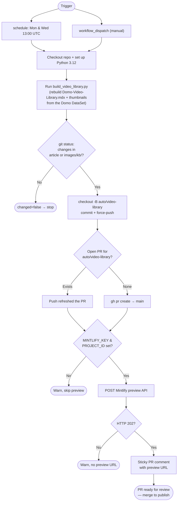
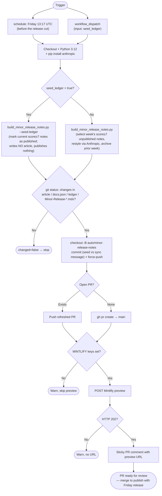
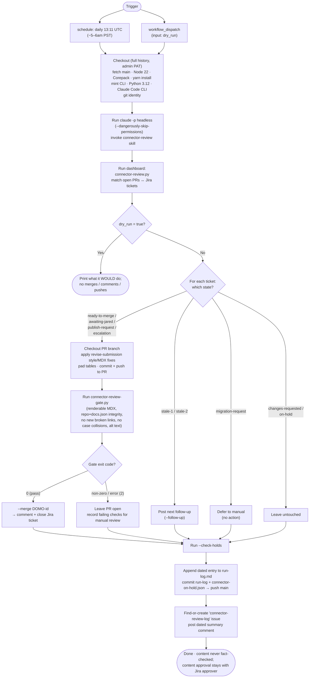

# Automated Workflows — Technical Contributor Guide

This document explains the repository's scheduled, PR-opening GitHub Actions for technical contributors. It is **not** writer-facing: non-technical KB authors never need to read or run anything here.

> **Note:** This is a `.md` file in `.github/workflows/`. GitHub Actions only loads `.yml`/`.yaml` files from this directory, so this doc is ignored by the Actions runner and exists purely as documentation alongside the workflows it describes.

The three workflows below share a common safe-by-default shape: they **regenerate content → push to a dedicated `auto/*` branch → open or update a reviewable PR**, and never publish directly to `main`. Nothing goes live until a human merges the PR. The Mermaid diagrams trace each workflow from its trigger through every decision point to its terminal states (including the quiet "nothing to do" exits).

These diagrams render natively on GitHub and in Mintlify (both support the ` ```mermaid ` fence).

---

## `sync-video-library.yml` — Sync Video Library

Rebuilds `s/article/Domo-Video-Library.mdx` and its thumbnails from a Domo DataSet, pushes to `auto/video-library`, and opens/updates a PR with a Mintlify preview.

- **Schedule:** Monday & Wednesday, 13:00 UTC (≈ 6–7am Mountain); also manual via `workflow_dispatch`.
- **Requires:** secret `DOMO_DEVELOPER_TOKEN`; variable `DOMO_VIDEO_DATASET_ID`; optional `DOMO_INSTANCE`, plus `MINTLIFY_KEY` / `MINTLIFY_PROJECT_ID` for the preview.



---

## `sync-minor-release-notes.yml` — Sync Minor Release Notes

Rebuilds `s/article/Current-Minor-Release-Notes.mdx` from the Domo hotfix enrichment DataSet (notes scored ≥ 7, not yet published, restyled into house voice via the Anthropic API), archives the outgoing week into a dated file + `docs.json` nav, pushes to `auto/minor-release-notes`, and opens/updates a PR. A one-time `seed_ledger` run bootstraps the published ledger without writing an article.

- **Schedule:** Friday, 13:17 UTC (≈ 6–7am Mountain, just before the release is cut); also manual via `workflow_dispatch` with a `seed_ledger` boolean input.
- **Requires:** secrets `DOMO_DEVELOPER_TOKEN`, `ANTHROPIC_API_KEY`; variable `DOMO_MINOR_RN_DATASET_ID`; optional `DOMO_INSTANCE`, `DOMO_MINOR_RN_TYPE_COLUMN`, plus the Mintlify preview secrets.



---

## `connector-review-daily.yml` — Connector Review Daily

Runs the `connector-review` skill unattended via Claude Code headless. It matches open connector PRs to their Jira tickets and, for each PR the secondary approver has already signed off on in Jira, runs the site-safety gate (`scripts/connector-review-gate.py`) in place of a manual GitHub approval. If the gate passes, the PR is auto-revised for style, approved, merged, and its Jira ticket commented + closed. **Content is never fact-checked** — this is code and rendering only; content approval still comes from the Jira secondary approver.

- **Schedule:** daily, 13:11 UTC (≈ 5–6am PST); also manual via `workflow_dispatch` with a `dry_run` boolean input.
- **Requires:** secrets `ANTHROPIC_API_KEY`, `JIRA_EMAIL`, `JIRA_API_TOKEN`, and `CONNECTOR_REVIEW_PAT` (an admin GitHub PAT exported as `GH_TOKEN` so merges bypass the `main` ruleset).


