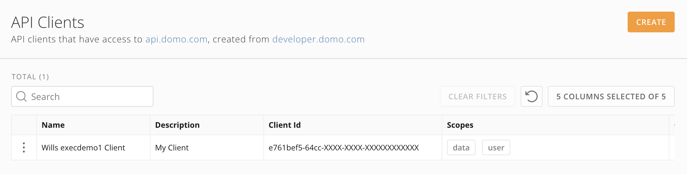
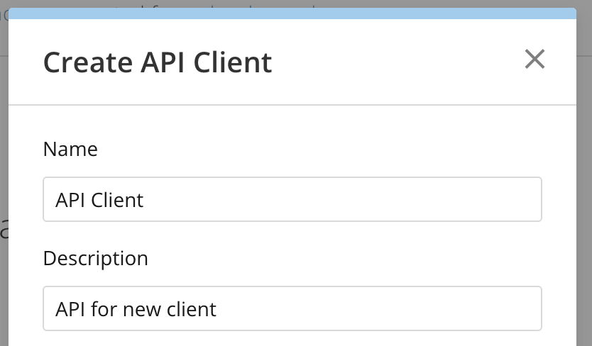
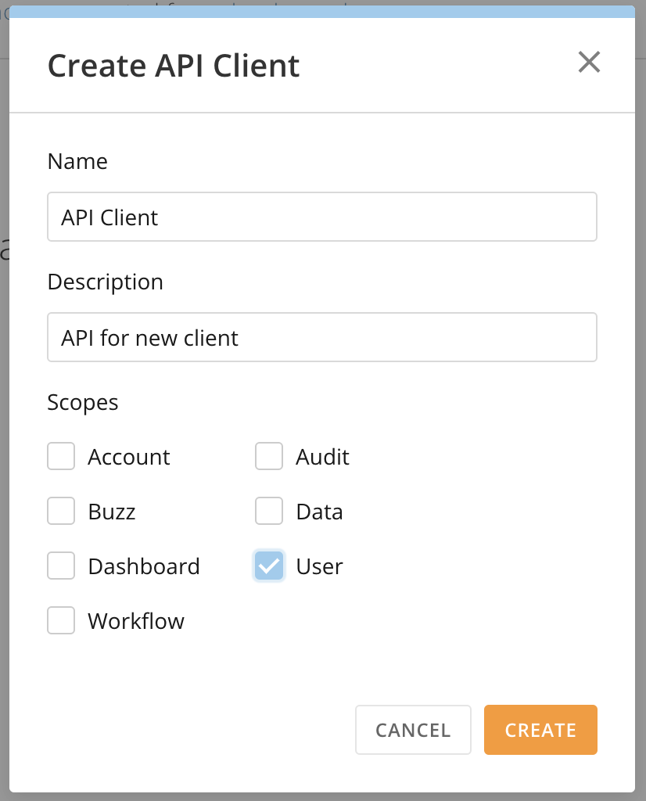
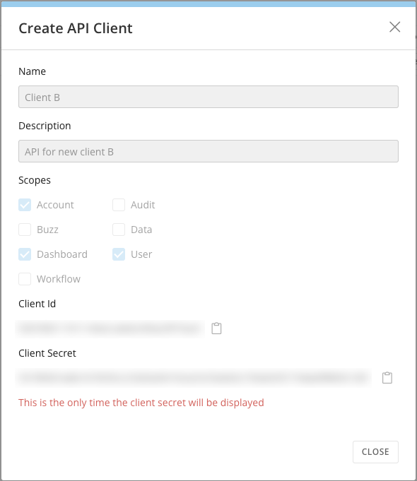
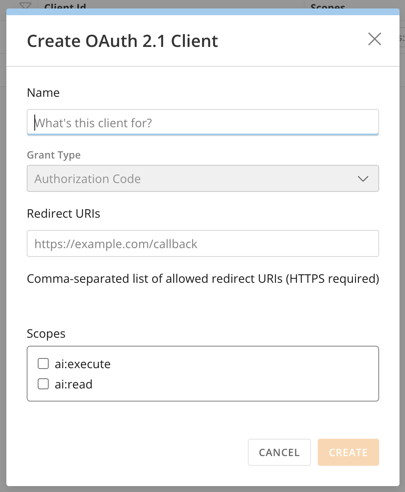
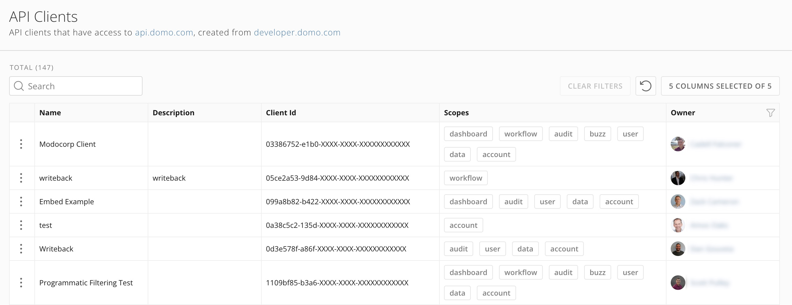
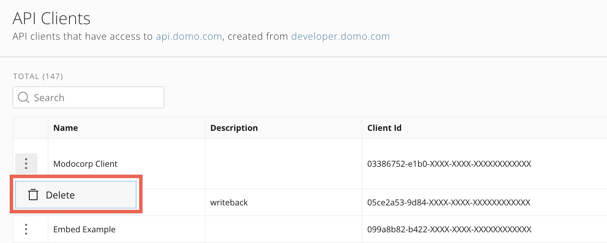
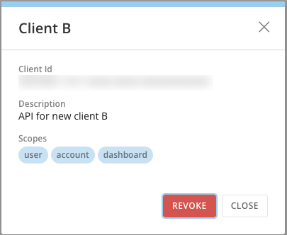

import { BetaNote } from '/snippets/BetaNote.mdx';

## Intro

The API Clients feature in the Admin Settings allows you to create and manage your own API clients and allows admin users to manage all API clients for your instance. API Clients displays a list of clients with their scopes and allows you to revoke clients that are no longer needed.

---

## Required Grants

You must have ONE of the following grants to access the API Clients feature:

- **Create API OAuth Clients —** Allows you to view and revoke your own API clients. You must have this grant to create API clients.
- **(Admin-only) Manage All Access Tokens and API Clients —** Allows admins to view and revoke all API clients in your Domo instance.

This table highlights the differences between the grants.

| Access                                        | Create API  OAuth Clients                                                              | Manage All Access Tokens and API Clients                                               |
| --------------------------------------------- | -------------------------------------------------------------------------------------- | -------------------------------------------------------------------------------------- |
| Create clients                                | <i className="icon-check-square-fill text-green-600 md" role="img" aria-label="Yes" /> | <i className="icon-x text-red-600 md" role="img" aria-label="No" />                    |
| View clients you own                          | <i className="icon-check-square-fill text-green-600 md" role="img" aria-label="Yes" /> | <i className="icon-check-square-fill text-green-600 md" role="img" aria-label="Yes" /> |
| View all clients in the instance              | <i className="icon-x text-red-600 md" role="img" aria-label="No" />                    | <i className="icon-check-square-fill text-green-600 md" role="img" aria-label="Yes" /> |
| Delete/revoke clients you create              | <i className="icon-check-square-fill text-green-600 md" role="img" aria-label="Yes" /> | <i className="icon-check-square-fill text-green-600 md" role="img" aria-label="Yes" /> |
| Revoke access for all clients in the instance | <i className="icon-x text-red-600 md" role="img" aria-label="No" />                    | <i className="icon-check-square-fill text-green-600 md" role="img" aria-label="Yes" /> |

## Access API Clients

Navigate to **Admin** > **Authentication** > **API Clients**.

<Frame></Frame>

## Create API Clients

<Note>**Note:** While API clients can also currently be created in the [Domo developer portal](https://developer.domo.com) <i className="icon-arrow-square-out" aria-hidden="true" />, this functionality will be removed in the future.</Note>

Users with the Create API OAuth Clients [grant](#required-grants) can follow these steps to create a client:

1. [Access](#access-api-clients) the API Clients feature and select **Create** to open the creation modal.
2. In the modal, enter a unique name and description for your client. To facilitate proper client governance, pick a name and description that captures the planned usage of the API client.   
     

   <Frame></Frame>
3. Select which scopes you want to give the client.

   
<Note>**Note:** Domo recommends adhering to the principle of least privilege by giving your client only those scopes required by your use case.</Note>

   <Frame></Frame>
4. Select **Create**. Upon confirmation, the ID and secret for your new client appear. 
<Warning>**Important:** This is the only time the client secret displays.</Warning>

   
<Warning>**Warning:** The client ID and secret are highly sensitive because they grant access to your Domo instance. Treat these credentials in accordance with your organization's security policies.</Warning>

   <Frame></Frame>

## Create an OAuth 2.1 Client <Badge>Beta</Badge>

<BetaNote />

An OAuth 2.1 client authenticates an external application to Domo through the authorization code flow. In the current release, OAuth 2.1 clients support only the MCP use case — connecting an MCP client to [Domo's MCP Server](/s/article/Connect-AI-Tools-to-Domo-Using-MCP). This is the preferred way to connect a tool that needs a client ID, secret, and redirect URI.

Users with the Create API OAuth Clients [grant](#required-grants) can follow these steps:

1. [Access](#access-api-clients) the API Clients feature and select **Create** > **Create OAuth 2.1 Client**.
2. In the modal, enter a **Name** that captures the client's planned usage. **Grant Type** is preset to **Authorization Code**.

   <Frame></Frame>
3. In **Redirect URIs**, enter the allowed redirect URI for the application you're connecting. Separate multiple URIs with commas. HTTPS is required.
4. Under **Scopes**, select **ai:read** and **ai:execute**. Both scopes are required to connect to Domo's MCP Server.
5. Select **Create**. The client ID and secret for your new client appear.

   <Warning>**Important:** This is the only time the client secret displays.</Warning>

   <Warning>**Warning:** The client ID and secret are highly sensitive because they grant access to your Domo instance. Treat these credentials in accordance with your organization's security policies.</Warning>

## View and Manage API Clients

The API Clients page lists active API clients in the Domo instance, depending on your [grants](#required-grants).

The list only displays partial client IDs, and the client secret is hidden to ensure security. The client's scope and owner are also displayed.

<Frame></Frame>

### Delete a Client

API clients can't be edited, but you can delete a client, depending on your [grants](#required-grants). To delete a client, follow these steps:

1. On the row for the client you want to delete, select <i className="icon-dots-vertical" aria-hidden="true" /> **More** (three vertical dots icon) > **Delete**.

   <Frame></Frame>
2. In the confirmation dialog, select **Revoke.**

   <Frame></Frame>

<Warning>**Important:** There is no warning dialog when you select **Revoke**—the client is removed. Ensure you are revoking the correct client, as this action cannot be undone. Note that existing sessions continue to be valid until they expire.</Warning>
