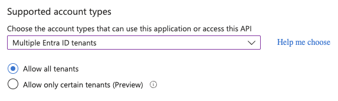
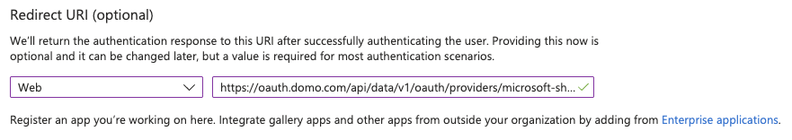
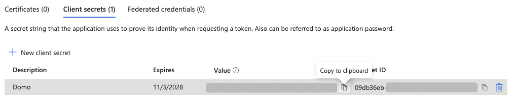

## Intro

Register an Entra app and add a SharePoint Online REST OAuth configuration so Domo can connect to SharePoint Online.

## Prerequisites

To connect to Microsoft SharePoint Online to retrieve the information, you must have the following. Instructions to obtain these items are provided in the following sections.

- A Microsoft Entra app registration.
- The Client ID and Client Secret. To register an app and generate these credentials, see [Microsoft's documentation](https://docs.microsoft.com/en-us/azure/active-directory/develop/quickstart-register-app) or the below instructions. You'll need the following information to register for the app:
  - **Entra Portal:** [https://entra.microsoft.com](https://entra.microsoft.com)
  - **Sharepoint App to Register:** SharePoint Online Rest API
  - **Domo Redirect URI:** `https://oauth.domo.com/api/data/v1/oauth/providers/microsoft-sharepoint-online-rest-enterprise-oauth/exchange`

## 1. Create an Entra App Registration

1. Log in to [https://entra.microsoft.com](https://entra.microsoft.com).

2. Select **Entra ID** > **App registrations**. Or navigate straight to [the app registrations page](https://entra.microsoft.com/#view/Microsoft_AAD_RegisteredApps/ApplicationsListBlade).

3. Select **+ New registration**.
   <Frame>
     
   </Frame>

4. Name your application.

5. Select the supported account type as **Multiple Entra ID tenants** then select **Allow all tenants**. This is a requirement for the connector.
   <Frame>
     
   </Frame>

6. Add a Redirect URI, select **Web** for the platform, and paste the following URL:

   ```text
   https://oauth.domo.com/api/data/v1/oauth/providers/microsoft-sharepoint-online-rest-enterprise-oauth/exchange
   ```

   <Frame>
     
   </Frame>

7. Finish by selecting **Register** at the bottom.

## 2. Add API Permissions

1. From your Entra app registration, go to the **API permissions** page.
   <Frame>
     
   </Frame>

2. Select **+ Add a permission**.

3. Select **Microsoft Graph** > **Delegated permissions**.

4. Search and check the following permissions:

   - OpenId permissions
     - `email`
     - `offline_access`
     - `openid`
     - `profile`
   - Files
     - `Files.Read.All`
   - Group
     - `Group.Read.All`
   - Notes
     - `Notes.Read.All`
   - Reports
     - `Reports.Read.All`
   - Sites
     - `Sites.Read.All`
   - User
     - `User.Read` (granted by default)
     - `User.Read.All`

5. Select **Add permissions** at the bottom to save your changes.

6. After adding the permissions, all configured permissions will be listed as below.
   <Frame>
     
   </Frame>

## 3. Obtain the Client ID

1. From your Entra app registration, go to the **Overview** page.
2. Under the **Essentials** section, find the **Application (client) ID**. This is your Client ID, paste it in your Domo connector **Client ID** field.

## 4. Create the Client Secret

1. From your Entra app registration, go to the **Certificates & secrets** page.
2. Under the **Client secrets (0)** tab, select **+ New client secret**.
3. (Optional) Enter a description.
4. Select an expiration period.
5. Select **Add** at the bottom.
6. Your new secret will appear. Copy the **Value** field and paste it in your Domo connector **Client Secret** field. Make sure to save this value somewhere secure, as you won't be able to retrieve it again after leaving this page.
   <Frame>
     
   </Frame>
