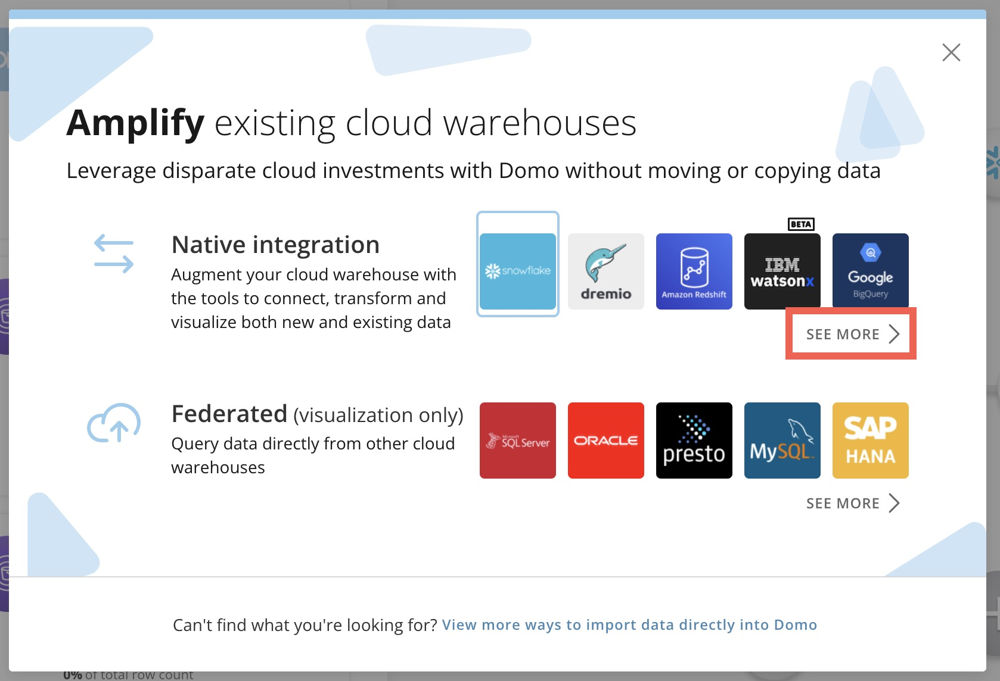
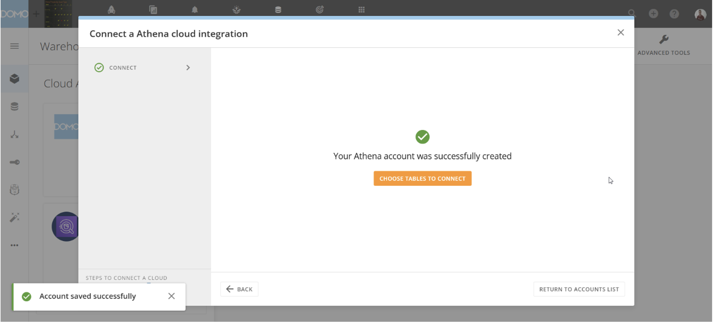
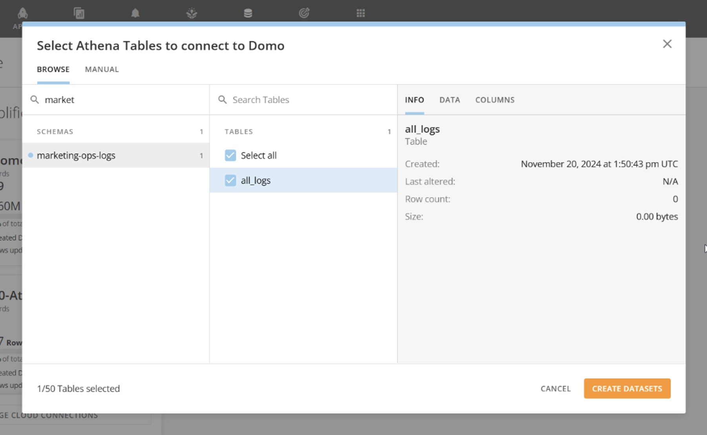
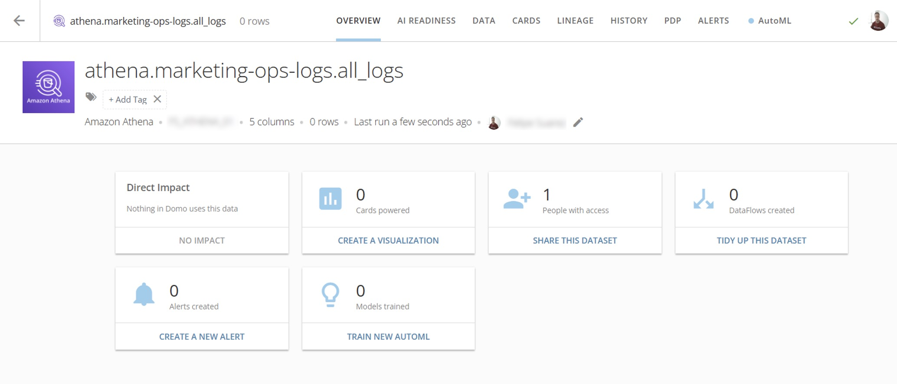

## Intro

Athena users can connect their data to Domo through Cloud Integrations native integrations. Integrating Athena into Domo is as simple as providing connection parameters and selecting the tables you want to see as Domo DataSets.

---

## Prerequisites

Before you set up an Athena integration, you must have an IAM role (ARN) with access to the information that you need to connect to Domo.

## Create an Athena Integration

Follow the steps below to create a read-only Athena integration:

<Steps titleSize="h3">
<Step title="Open the Data Warehouse">
In Domo, go to the <i className="icon-data-warehouse" aria-hidden="true" /> **Data Warehouse** and select <i className="icon-plus" aria-hidden="true" /> **Add New Cloud Account**.
</Step>
<Step title="Expand the Native Integration Options">
In the **Amplify existing cloud warehouses** modal, under **Native integration**, choose **See More**.

<Frame></Frame>
</Step>
<Step title="Choose the Athena Tile">
Choose the **Athena** tile.
</Step>
<Step title="Add a New Integration">
Select **+ Add New Integration**. If there are existing integrations, this option displays at the bottom of the list.
</Step>
<Step title="Enter the Integration Details">
Enter the information listed in the table below and select **Next**.

| Parameter | Description |
| --- | --- |
| Integration name | This is how you can find your integration in the Athena integrations list for future updates. |
| (Optional) Description | Any additional information about the integration. |
| Athena connection URL | The Athena JDBC connection URL. |
| IAM Role (ARN) | The Identity and Access Management (IAM) role that you've previously configured for your Athena instance. |
</Step>
<Step title="Configure Caching Options">
Configure the caching options and select **Next**. Learn about [caching rules](/s/article/4412849158167) with Cloud Integrations.

A success message displays.

<Frame></Frame>
</Step>
<Step title="Choose Data Tables to Connect">
Select **Choose Data Tables to Connect**.
</Step>
<Step title="Select Schemas and Tables">
Use the table picker to choose the Athena schemas and tables to connect to Domo.

<Frame></Frame>
</Step>
<Step title="Create DataSets">
Select **Create DataSets** to open the sharing modal. Here you have the option to share the data with individuals and groups and choose their access level.
</Step>
</Steps>

Your Athena DataSets now display in the Domo **DataSets** feature.

<Frame></Frame>
