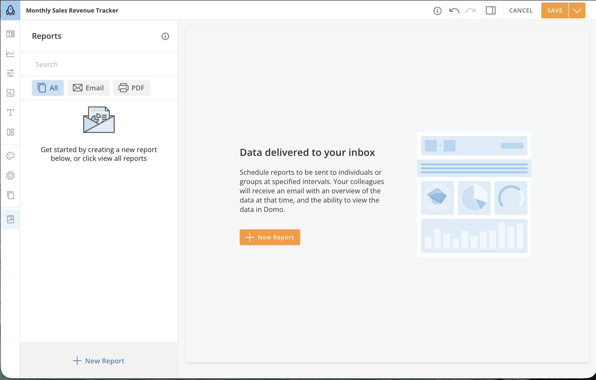
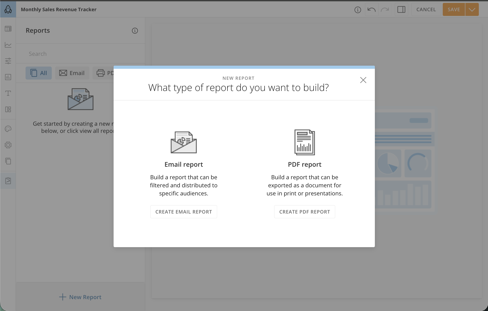
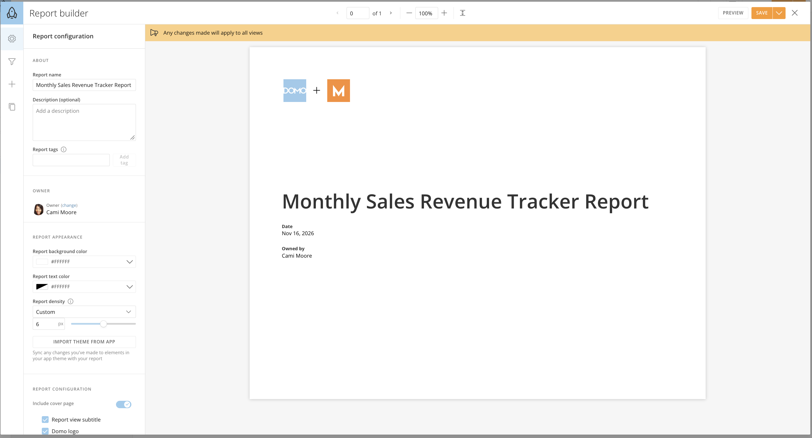
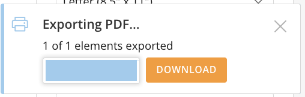

## Intro

App Studio Report Builder allows you to create and automate personalized email reports and PDF reports from your App Studio apps.

This article covers topics like [creating a report](#create-a-report), [configuring](#configure-your-report) [a](#configure-your-report) [report](#configure-your-report), [generating and downloading a PDF report](#generate-and-download-a-pdf-report), and [setting a report schedule](#schedule-your-report).

<Tip>
  **Tip:** Learn how to [create an app](/s/article/000005295#create-an-app) in App Studio.
</Tip>

---

## Required Grant

To create, edit, update, and delete reports in Report Builder, you must have the following grant enabled for your role:

* **Edit Report (Report Builder) —** Report Builder only appears as an option in App Studio if you have this grant, which is enabled for Admins and editors by default.

To learn more about grants, see [Manage User Roles and Grants](/s/article/360043438973).

## Access Report Builder

Follow the steps below to access Report Builder in App Studio.

<Tip>
  **Don't see the Report Builder option?**

  Make sure you have the [required grant](#required-grant).

</Tip>

1. In App Studio, choose to create a new app or edit an existing app.
2. From the left navigation, select the Reports icon  **Reports**.
     
   This opens the **Reports** panel with all of your existing reports. Filter the list by **All**, **Email**, or **PDF**.

   <Frame>
     
   </Frame>

## Create a Report

Follow these steps to create a new report:

1. In the **Reports** panel, select **+ New Report**.  
   A modal displays with two options: **Email report** and **PDF report**.
2. Select **Create Email Report** or **Create PDF Report**.

   <Frame>
     
   </Frame>

3. In the next modal, choose how to add content to the report:
   - **From the app —** Choose content from this app to generate the report.
   - **Add content yourself —** Drag and drop content to build your own report.
   - **Use Report —** Import content from an existing report.

   The Report Builder editor opens. From here, [configure your report](#configure-your-report).

   <Frame>
     
   </Frame>

### Create a Report From the App

Follow these steps to create a report from your app:

1. In the **Create New Email Report** modal, select **Choose Content**.
     
   <Frame></Frame>
2. Under **Choose app pages**, select the specific pages you want to include in your report, then select **Next.** **Note:** Buttons, tabs, and controls on app pages are excluded from the report.

   <Frame></Frame>
   The Report Builder interface opens and displays the pages you selected.
3. From here, configure your report. This process is described
   [below](#configure-your-report).

   <Frame></Frame>
### Create a Report Using Your Own Content

Follow these steps to create a report using your own content:

1. In the **Create New Email Report** modal, select **Add Content**.

   <Frame></Frame>
   The Report Builder interface opens.
2. From here, configure your report. This process is described
   [below](#configure-your-report).
     
   <Frame></Frame>
## Configure Your Report

From the Report Builder, you can do the following:

* [Edit report name, description, and tags](#edit-report-name-description-and-tags)
* [Design report appearance](#design-report-appearance)
* [Edit report configuration](#edit-report-configuration)
* [Add actions and elements](#add-actions-and-elements)
* [Delete report](#delete-report)

<Note>
  **Note:** Changes to the report layout or other report settings apply to all report views and their schedules.
</Note>

### Edit Report Name, Description, and Tags

Under **About** in the left panel of the Report Builder, edit the report name and description and add report tags.

<Frame></Frame>
* By default, the report automatically inherits the name of your app.
* Report tags help you organize and categorize reports. Tags cannot include apostrophes, underscores, backslashes, percent signs, or emojis.

<Frame></Frame>
### Design Report Appearance

Under **Report Appearance** in the left panel of the Report Builder, you can choose a report background color and the amount of density (the space around objects in the report).

<Frame></Frame>
Selecting **Import Theme From App** opens the App Studio themes modal. Learn more about [App Studio themes](/s/article/000005543).

<Note>
  **Note:** Supported theme components include chart color palette, layout density (minor rendering differences), background colors, borders, and rounded corners (minor rendering differences). Spacing and density may vary.
</Note>

<Frame></Frame>
<Warning>
  **Important:** If changes are made to the *theme* used in the report after the report is created, those changes are NOT automatically synced with the report. The report continues to use the theme as it was when the report was created. To update your report theme, use the **Import Theme From App** option to reassign the theme or choose another.
</Warning>

### Edit Report Configuration

Use the **Report Configuration** section in the left panel of the Report Builder to make changes to the report header and footer, including whether to display the Domo logo and text and background colors.

When you're finished, save your changes to add the new/updated report to your list of reports.

<Frame></Frame>
### Add Actions and Elements

You can add the following to your reports by dragging and dropping each item onto your report in the plus icon <i className="icon-plus" aria-hidden="true" /> **Add actions and elements** section of the Report Builder:

* Headers
* Borders
* Images
* Text
* Cards
* Controls

These function as they do throughout App Studio. [Learn more](/s/article/000005295#add-actions-and-elements) about how these items work.

<Frame></Frame>
### Delete Report

Under **Delete Report** in the left panel of the Report Builder, you can delete your report. This action cannot be undone.

<Frame></Frame>

## Generate and Download a PDF Report

After you configure a PDF report, save it and generate the PDF:

1. In the Report Builder editor, select the arrow icon <i className="icon-chevron-down" aria-hidden="true" /> next to **Save**, then select **Save and generate PDF**.  
   The report exports, and an **Exporting PDF** message shows the export progress.
2. Select **Download**.  
   The report downloads as a PDF.

<Frame>
  
</Frame>

## Create Report Views

To help your report viewers see the content most appropriate for them, you can choose filters and variables for each report in the funnel icon <i className="icon-funnel" aria-hidden="true" /> **Report Views** section of Report Builder. There is no limit on the number of report views you can create.

<Note>
  **Note:** Changes to the report configuration or other report settings apply to all report views and their schedules.
</Note>

<Frame></Frame>
To create a new report view, select **+ New Report View**.

<Frame></Frame>
In the Report View editor, you can [add filters](#add-filters), [schedule delivery](#schedule-your-report) for the report view, and [choose recipients](#add-report-recipients) for the report view. These tasks are described below.

### Add Filters

Under **<i className="icon-funnel" aria-hidden="true" /> Report Views** > **Filters** (tab), add filters to your report using the data in your app report and date range filters.

<Frame></Frame>
<Note>
  **Note:** Filters are not a substitute for PDP (Personalized Data Permissions). Filters help customize views, but do not enforce data security. Use PDP as you would for other scheduled reports.
</Note>

### Schedule Your Report

After configuring your report and adding any filters to a particular report view, you can schedule your report view and begin distributing it to others. Under **<i className="icon-funnel" aria-hidden="true" /> Report Views** > **Schedule** (tab), you can choose when that report view should be emailed to recipients.

Use the fields to give your report email a subject, choose the frequency for report delivery (daily, weekly, or monthly), and a start and end date.

<Frame></Frame>
<Warning>
  **Enable schedule:** You must enable your configured report schedule by toggling the **Enabled** button on. If you do not enable the report, it will not be sent as scheduled.
</Warning>

### Schedule a PDF Report

Schedule a PDF report from the same **<i className="icon-funnel" aria-hidden="true" /> Report Views** > **Schedule** (tab) that you use for email reports. Recipients receive the report as a PDF attached to the email. The PDF is generated when the report is sent, so it reflects the data at that time.

{/* TODO (pending confirmation): Save & Send Now. The PRD says you can send a PDF report view immediately with Save & Send Now instead of a recurring schedule. Confirm where the option is and its exact label, then add a step here. */}

<Note>
  **Note:** PDF attachments are limited to 8 MB. If the PDF is larger, the email is sent without the attachment and includes a note explaining why.
</Note>

### Add Report Recipients

Under **<i className="icon-funnel" aria-hidden="true" /> Report Views** > **Recipients** (tab), you can choose who should receive it. Recipients receive the report by email.

You can also choose who owns the report view.

<Frame></Frame>

{/* TODO (pending confirmation): Export Reports From Embedded Apps. Confirm the checkbox label and the button action names, then replace this comment with the section below.

## Export Reports From Embedded Apps

When you embed an app privately, viewers can download PDF reports and send reports from the embedded app through button actions.

To allow report exports in a private embed, select the following options when you embed the app:

- **Allow filtering and interactions**
- **Allow Export**
- **Allow Export Interactions** [CONFIRM LABEL]

**Allow Export Interactions** is available only for private embeds with **Allow Export** and **Allow filtering and interactions** selected. If you switch the embed to public, the option is cleared and disabled.

To let viewers export a report, add a button to the app with the [CONFIRM ACTION NAMES: download PDF / send report] action. Learn how to [embed an app](/s/article/000005295#embed-an-app).

<Note>
  **Note:** Public embeds don't support downloading or sending reports. Viewers can't create or edit report schedules in an embedded app.
</Note>
*/}

{/* TODO (pending confirmation): Download an App Page as a PDF (Quick PDF Download). Confirm whether Download as PDF is in the Distribute menu or the Share menu, then replace this comment with the section below.

## Download an App Page as a PDF

Download an App Studio page as a PDF without building a report.

1. In the App Studio app editor, open **Page settings** and turn on **Display page breaks**.
2. Fit the page content within the page breaks.
3. Make sure all page content has loaded.
4. Select **[CONFIRM: Distribute or Share]** > **Download as PDF**.  
   The page downloads as a PDF.

<Note>
  **Note:** Tabs and buttons don't render fully in the PDF. If the page content is taller than one PDF page, **Download as PDF** is unavailable. To build a multipage PDF, [create a PDF report](#create-a-report) instead.
</Note>
*/}

## FAQ

<AccordionGroup>
<Accordion title="Can I include content from other apps in my reports?">

Yes, you can add cards and content that you own or have access to, even if they are located outside of the current app you are editing. [Add a card element](#add-actions-and-elements) to your report and choose a card from another app.

<Note>
  **Note:** All reports are tied to the app where they are created and appear in the **Reports** panel in that app.
</Note>

</Accordion>
<Accordion title="Can I use app buttons in reports? Can I add new ones?">

App buttons do not carry over into Report Builder. However, you can add a custom button in the report header that links to outside content, including the original app, dashboards, and cards. Learn how to configure this button [above](#edit-report-configuration).

</Accordion>
<Accordion title="How do tabs appear in reports?">

Tabs from your app are stacked vertically in the report.

</Accordion>
<Accordion title="Are charts and tables clickable in reports?">

No, charts and tables are static in reports. However, you can add a button that links users to interactive content. Learn how to configure this button [above](#edit-report-configuration).

</Accordion>
<Accordion title="Are tables supported?">

Yes, reports display table snapshots similar to the existing scheduled reports functionality. Learn more about scheduled reports.

</Accordion>
<Accordion title="How does dark mode for email clients affect reports?">

Dark mode may alter background and header colors in email, but it won't affect your charts or data visuals.

</Accordion>
<Accordion title="Can I use custom fonts in PDF reports?">

No. Custom fonts aren't supported in PDF reports.

</Accordion>
</AccordionGroup>
