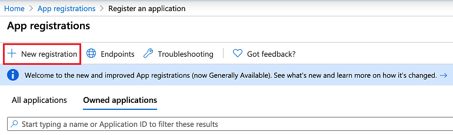
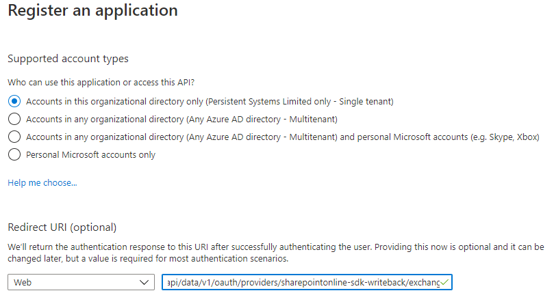
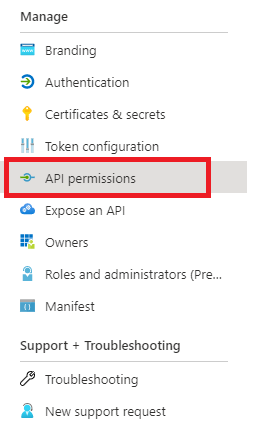
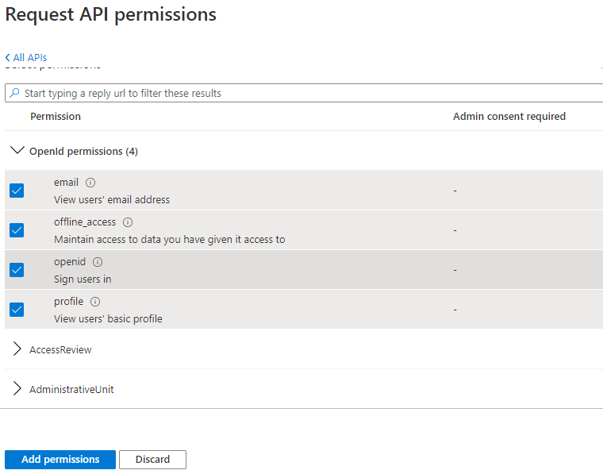
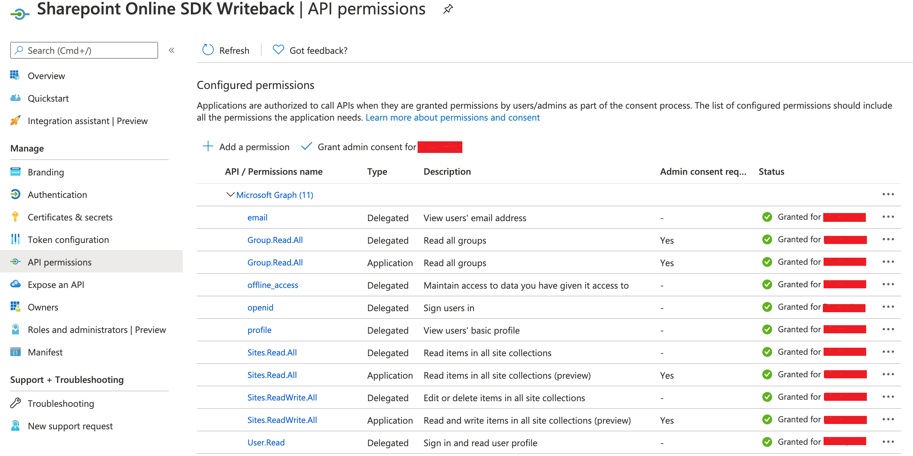
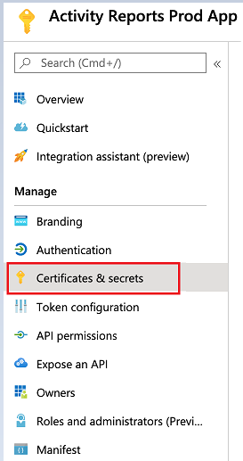
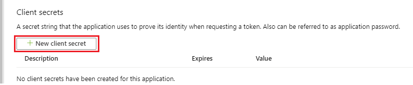
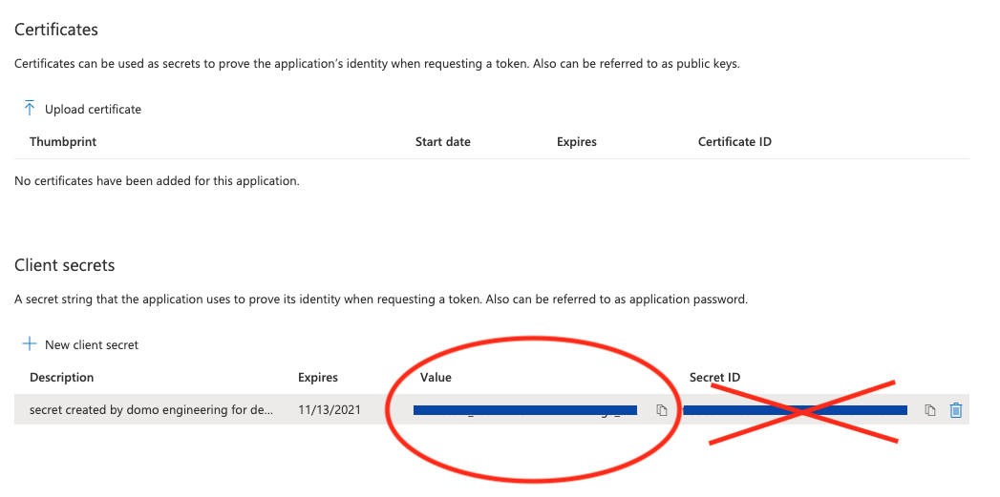

## Intro

Microsoft SharePoint Online is a collaborative platform that allows an enterprise to store, retrieve, search, archive, track, manage, and report on digitized documents. You can easily create and manage custom, team-focused, and project-focused documents for collaboration. Use Domo's Microsoft SharePoint Online Writeback connector to export your data from a Domo DataSet to your SharePoint Online site. To learn more, see the [SharePoint API documentation](https://msdn.microsoft.com/en-us/library/office/jj860569.aspx).

You configure your Domo-SharePoint connection in the Data Center. This topic discusses the fields and menus that are specific to the Microsoft SharePoint Online Writeback connector user interface. General information for adding DataSets, setting update schedules, and editing DataSet information is discussed in [Adding a DataSet Using a Data Connector](/s/article/360042926274).

<Note>**Note:** The owner of a writeback DataSet must also be an owner or co-owner of the input DataSet.</Note>

## Prerequisites

To configure this connector, you must have the following:

- An installed Microsoft Azure app.
- The Secret ID and Value associated with your Microsoft Azure app.
- The Tenant ID for your Azure app. This is generated when you create your Azure app.

### Obtain the Azure App Client ID

1. Go to [https://portal.azure.com](https://portal.azure.com).
2. Select **Azure Active Directory > App registrations**.
3. Find and select your web app.
4. The "application" ID is your Client ID.

### Obtain a New Azure App Client Secret

1. Go to [https://portal.azure.com](https://portal.azure.com).
2. Select **Azure Active Directory > App registrations**.
3. Find and select your web app.
4. Open **Certificates and secrets**.
5. Click **+ New client secret**.
6. Provide the client secret description and the expiry period for your secret. Click **Add**.
7. Your new client secret appears. Copy it and paste it in your Domo connector Client Secret field.

### Obtain the Tenant ID

1. Log in to the Azure Portal ([https://portal.azure.com](https://portal.azure.com)).
2. Navigate to **Azure Active Directory > Properties**.
3. Copy the **Directory ID**. The directory ID is your **Tenant ID**.

### Create an Azure App for Enterprise OAuth

To create a Microsoft Azure app, do the following:

1. Log into [https://portal.azure.com](https://portal.azure.com).

2. Click **App registrations**.

   <Frame>
     
   </Frame>

3. Click **New registration**.

4. Enter the application name and select the supported account type as below. Enter the Redirect URI for Web as `https://oauth.domo.com/api/data/v1/oauth/providers/sharepointonline-sdk-writeback/exchange`.

   <Frame>
     
   </Frame>

5. Click **Register**.

6. The **Application ID** that appears here is the SharePoint **Client ID** you will enter in the **Credentials** pane in Domo. Once the application is registered, assign the required API permissions for your application.

7. Click **API Permissions**.

   <Frame>
     
   </Frame>

8. Click the **+ Add Permissions** button.

   <Frame>
     
   </Frame>

9. Select the permissions as required.

   <Frame>
     
   </Frame>

10. After adding the permissions, the configured permissions are listed.

    <Frame>
      
    </Frame>

11. Click **Certificates & Secrets**. Certificates can be used as secrets to prove the application's identity when requesting a token; they can also be referred to as public keys.

    <Frame>
      
    </Frame>

12. Click the **+ New Client Secret** button.

    <Frame>
      
    </Frame>

13. Specify the client secret description and the expiry period for your client secret, and click **Add**.

    <Warning>**Important:** Ensure that you copy the client secret Value (not the Secret ID) before leaving the page. It is not displayed again after you leave this page.</Warning>

    <Frame>
      
    </Frame>

14. Copy the value and paste it into the **Client Secret** field in the connector credentials section in Domo.

## Configure the Connection

This section enumerates the options in the **Credentials** and **Details** panes in the Microsoft SharePoint Online Writeback connector page. The components of the other panes in this page, **Scheduling** and **Name & Describe Your DataSet**, are universal across most connector types and are discussed in greater length in [Adding a DataSet Using a Data Connector](/s/article/360042926274).

### Credentials Pane

This pane contains fields for entering credentials to connect to your Microsoft SharePoint Online account. The following table describes what is needed for each field:

| Field                           | Description                                                                                                                                                                                              |
| ------------------------------- | -------------------------------------------------------------------------------------------------------------------------------------------------------------------------------------------------------- |
| Azure Application Client ID     | Enter the client ID (GUID) of the client web app obtained from Azure Active Directory configuration. For more information, see [How to obtain the Azure App Client ID](#obtain-the-azure-app-client-id). |
| Azure Application Client Secret | Enter the secret key of the client web app. For more information, see [How to obtain the Azure App Client Secret](#obtain-a-new-azure-app-client-secret).                                                |
| Tenant ID                       | Enter your Tenant ID. For more information, see [How to obtain the Tenant ID](#obtain-the-tenant-id).                                                                                                    |
| Azure National Cloud            | Select the Azure National Cloud.                                                                                                                                                                         |

Once you have entered valid Microsoft SharePoint Online credentials, you can use the same account any time you go to create a new Domo-SharePoint connection. You can manage connector accounts in the **Accounts** tab in the Data Center. For more information about this tab, see [Managing User Accounts for Connectors](/s/article/360042926054).

### Details Pane

This pane contains a primary **Reports** menu, along with various other menus which may or may not appear depending on the report type you select.

| Menu                                   | Description                                                                                                                                                                                                                                                                                                                                                                                                             |
| -------------------------------------- | ----------------------------------------------------------------------------------------------------------------------------------------------------------------------------------------------------------------------------------------------------------------------------------------------------------------------------------------------------------------------------------------------------------------------- |
| Input DataSet ID                       | Enter the DataSet ID (GUID) for the DataSet you want to copy to SharePoint Online. You can find the ID by opening the details view for the DataSet in the Data Center and looking at the portion of the URL following `datasources/`. For example, in the URL `https://mycompany.domo.com/datasources/845305d8-da3d-4107-a9d6-13ef3f86d4a4/details/overview`, the DataSet ID is `845305d8-da3d-4107-a9d6-13ef3f86d4a4`. |
| Select Filename                        | Select how you want to choose the file where data will be copied. **Use Input DataSet GUID** — the filename is the number you entered for **Input DataSet ID**. **Enter File Name** — you give the file a custom name in the **File Name** field.                                                                                                                                                               |
| Filename                               | Enter the desired output filename.                                                                                                                                                                                                                                                                                                                                                                                      |
| How would you like to select the site? | Specify whether you would like to use the site discovery or site search method to select your site.                                                                                                                                                                                                                                                                                                                     |
| Sites Discovery                        | Select the site that you would like to use.                                                                                                                                                                                                                                                                                                                                                                             |
| Site Search Query                      | Enter the search query to obtain the sites.                                                                                                                                                                                                                                                                                                                                                                             |
| Where to Store the File?               | Select the folder name inside which your file needs to be stored. You can select 'Root' if you want to store the file at the root level of the selected site.                                                                                                                                                                                                                                                           |
| Select Mode                            | Select the required mode. In **Rename** mode, if the file name already exists then it is renamed by appending filename 1 or filename 2 and so on. In **Replace** mode, if the file name already exists then the old file is replaced with the new file.                                                                                                                                                                 |

### Other Panes

For information about the remaining sections of the connector interface, including how to configure scheduling, retry, and update options, see [Adding a DataSet Using a Data Connector](/s/article/360042926274).
