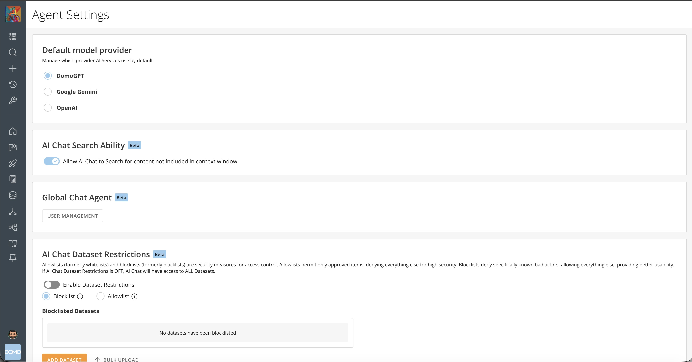
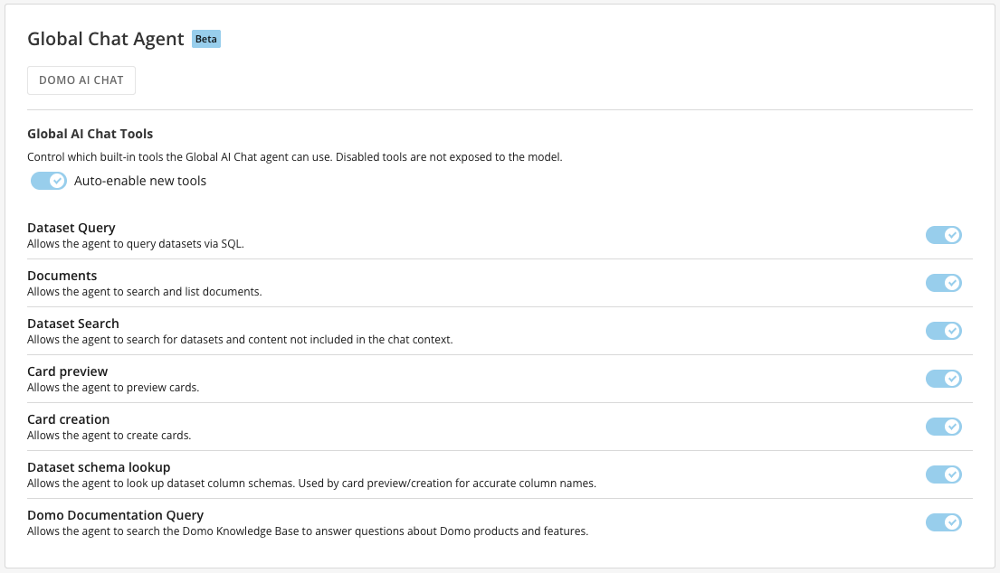

import { BetaNote } from '/snippets/BetaNote.mdx';

## Intro

This article explains the AI Agent settings available in the Admin Settings, including how to set the default model provider, enable AI Chat search ability, choose the global chat agent, and manage AI Chat DataSet restrictions.

---

## Access AI Agent Settings

Go to the **Admin** tab in the left navigation, then select **AI Service Layer** > **AI Agent Settings**.

<Frame></Frame>

## Default Model Provider

Manage which provider AI Services use by default.

## AI Chat Search Ability <Badge className="text-primary bg-primary/10 font-bold">Beta</Badge>

<BetaNote />

Allow AI Chat to search for content not included in the context window.

## Global Chat Agent <Badge className="text-primary bg-primary/10 font-bold">Beta</Badge>

Choose which agent is the **default** chat agent.

If the Domo-provided AI Chat is selected, you have the following settings to control. If a custom agent is selected, those controls are part of the agent's configuration.

<Frame>
  
</Frame>

## AI Chat DataSet Restrictions <Badge className="text-primary bg-primary/10 font-bold">Beta</Badge>

Allowlists (formerly whitelists) and blocklists (formerly blacklists) are security measures for access control. Learn more about [DataSet Restrictions](/s/article/AI-Chat-DataSet-Restrictions).
