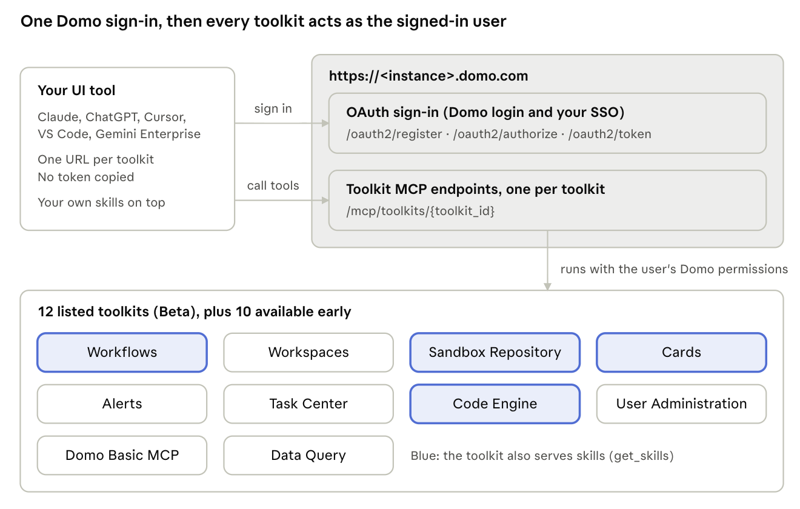

<Note>
  **Note:** Domo AI is available to customers on a consumption agreement. Those not on a consumption agreement can request a trial by reaching out to their Customer Success Manager (CSM).
</Note>

## Required Grants

To use the MCP feature, the following grants must be enabled for your role:

- **Use AI Services —** Access to features and Apps built using the AI Services Layer.
- **Use AI Chat —** Access to the Domo AI Assistant.
- **Use MCP —** Access to connect external AI tools to Domo's MCP Server.

Learn more about [grants](/s/article/360043438973).

## How it fits together

<Frame></Frame>

After you're connected, you can use your AI tool to:

- Query data in your Domo DataSets
- List, Query Document Collections stored in Domo
- Search across your Domo instance
- Query Domo Documentation
- Create, update, and manage Domo alerts and subscriptions on cards and datasets.
- Create queues, search and count queue activity, access task history, and monitor watchlists..
- Create, validate, deploy, test and manage workflows and monitor and search executions
- Create and edit Code Engine packages
- Help manage User accounts and permissions
- Create, list, retrieve, delete, commit versions to, share, and promote Sandbox repositories.

<Note>**Note:** A Toolkit's tools only return data and perform actions that the connected Domo account already has permission to access.</Note>

## Connect to the Domo MCP Server

- [Standard OAuth](/s/article/MCP-Standard-OAuth)
- [Manually Connect](/s/article/MCP-Manually-Connect)

Step-by-step guides are available for [Amazon Quick Suite](/s/article/Connect-Amazon-Quick-Suite-To-Domo-MCP), [Antigravity](/s/article/Connect-Antigravity-to-Domo-MCP), [Claude Code](/s/article/Connect-Claude-Code-to-Domo-MCP), [Claude Desktop](/s/article/Connect-Claude-Desktop-to-Domo-MCP), [Codex CLI](/s/article/Connect-Codex-CLI-to-Domo-MCP), [Cursor](/s/article/Connect-Cursor-to-Domo-MCP), [Gemini Enterprise](/s/article/Connect-Gemini-Enterprise-to-Domo-MCP), [GitHub Copilot CLI](/s/article/Connect-GitHub-Copilot-CLI-to-Domo-MCP), [Kiro](/s/article/Connect-Kiro-to-Domo-MCP), and [VS Code](/s/article/Connect-VS-Code-to-Domo-MCP).

## Consumption Considerations for MCP

MCP tool calls don't incur AI operation charges. However, if the tool that gets called uses any of the Domo-provided models, input and output token charges can apply.
