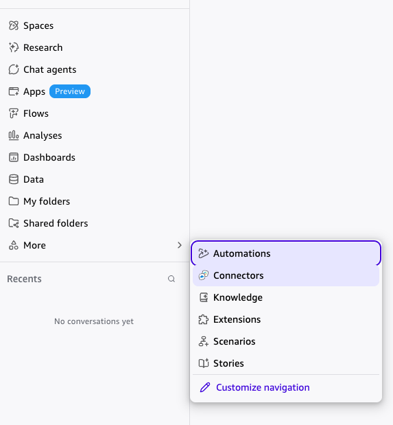
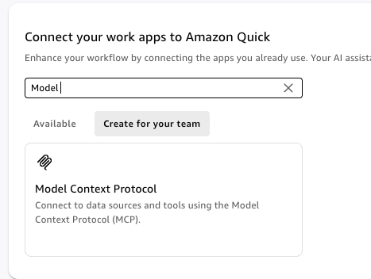
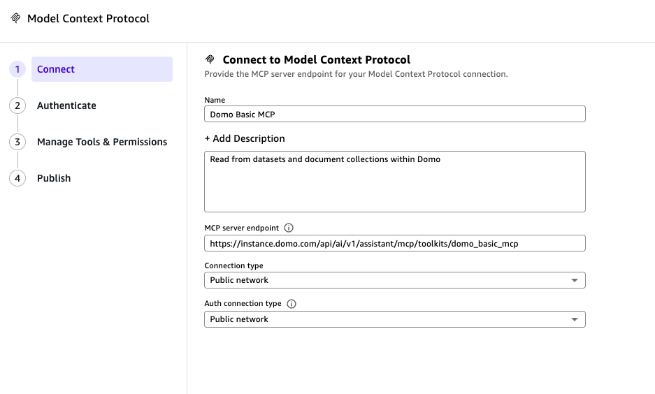
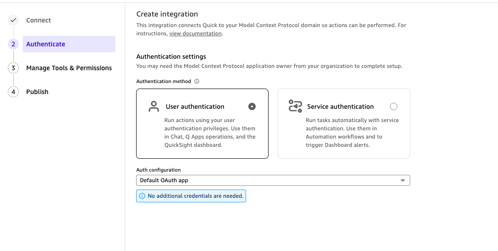
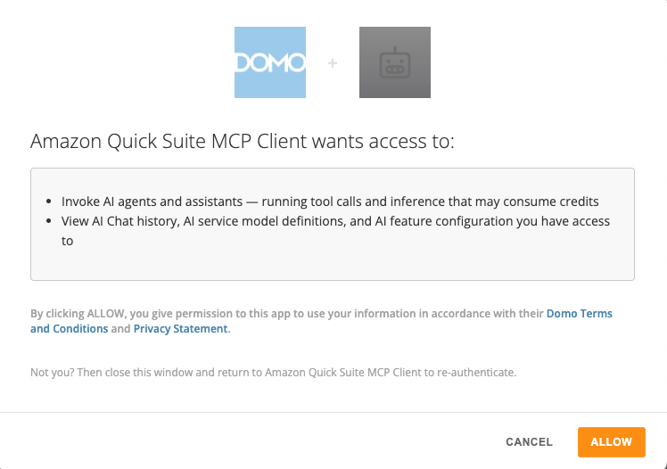
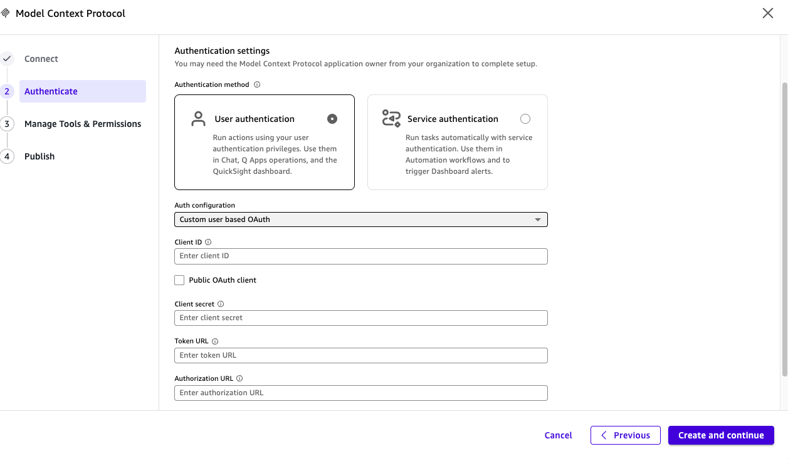

import { BetaNote } from '/snippets/BetaNote.mdx';

<BetaNote/>

## Required Grants

To use the AI Library feature, the following grants must be enabled for your role:

- **Use AI Services —** Access to features and Apps built using the AI Services Layer.
- **Use AI Chat —** Access to the Domo AI Assistant.
- **Use MCP —** Access to connect external AI tools to Domo's MCP Server.

Learn more about [grants](/s/article/360043438973).

## Prerequisites

- Access to the Amazon Quick web console with permission to create connectors for your team.

- The **Domo MCP** server endpoint from the AI Library:

  ```
  https://<instance>.domo.com/mcp
  ```

<Tip>**Tip:** For background on connecting external tools to Amazon Quick agents, see the AWS blog post [Integrate external tools with Amazon Quick agents using Model Context Protocol (MCP) <i className="icon-arrow-square-out sm" aria-hidden="true"/>](https://aws.amazon.com/blogs/machine-learning/integrate-external-tools-with-amazon-quick-agents-using-model-context-protocol-mcp/), which also includes a guide for setting up Dynamic Client Registration (DCR).</Tip>

## Connect Amazon Quick Suite (Web)

Connecting with the default OAuth app is recommended. Use a Client ID and Secret only if your Amazon Quick environment doesn't offer **Default OAuth app** as an **Auth configuration** option.

<Tabs>
  <Tab title="OAuth">
    <Steps>
      <Step title="Open Connectors">
        Log in to the [Amazon Quick web console](https://profile.aws.amazon.com/#/discovery/quicksight?autologin=true). In the left navigation, select **More**, then select **Connectors**.

        <Frame></Frame>
      </Step>

      <Step title="Create the Connector">
        Select **Create for your team**. Then search for **Model Context Protocol** and select it from the results.

        <Frame></Frame>
      </Step>

      <Step title="Enter the Connection Details">
        On the **Connect** step, fill in the following fields:

        - **Name —** A name for the connector, such as `Domo MCP`.
        - **Description —** An optional description, such as `Read from datasets and document collections within Domo`.
        - **MCP server endpoint —** `https://<instance>.domo.com/mcp`
        - **Connection type —** Public network
        - **Auth connection type —** Public network

        <Frame></Frame>
      </Step>

      <Step title="Keep the Default OAuth App">
        On the **Authenticate** step, leave **Auth configuration** set to **Default OAuth app** and select **Create and continue**.

        <Frame></Frame>
      </Step>

      <Step title="Allow Access to Domo">
        A pop-up displays asking you to allow Amazon Quick Suite MCP Client access to Domo. Select **Allow**.

        <Frame></Frame>

        <Note>**Note:** If you don't get a pop-up, make sure your browser isn't blocking pop-ups for the Amazon Quick domain.</Note>
      </Step>

      <Step title="Publish and Test the Connector">
        Select **Next** to continue through the remaining steps, then select **Publish & test**.

        <Note>**Note:** On the **Manage Tools & Permissions** step, the `domo_mcp` server doesn't currently expose any write tools, so this step may not populate. This can change in the future.</Note>
      </Step>
    </Steps>
  </Tab>

  <Tab title="Client ID and Secret">
    <Warning>**Important:** Use the **OAuth** tab instead of this method whenever possible.</Warning>

    <Steps>
      <Step title="Switch to Custom User Based OAuth">
        Follow steps 1 through 3 in the **OAuth** tab to create the connector and reach the **Authenticate** step. Then select the **Auth configuration** dropdown and change it to **Custom user based OAuth**.

        At the bottom of the screen, note the **Redirect URL**. You need it for the next steps, which are performed outside of Amazon Quick.
      </Step>

      <Step title="Generate a Domo Access Token">
        In Domo, generate an access token. See [Self-Serve Access Token Creation (Beta)](/s/article/360042934494#self-serve-access-token-creation-beta) for instructions, then copy and save the token.
      </Step>

      <Step title="Register an OAuth Client in Domo">
        Open a terminal and run the following curl command, replacing `<instance>` with your Domo instance domain and `<token>` with the access token you generated:

        ```bash
        curl -i -X POST \
          "https://<instance>.domo.com/oauth2/admin/clients" \
          -H "X-DOMO-Developer-Token: <token>" \
          -H "Content-Type: application/json" \
          -d '{
            "client_name": "Amazon Quick MCP",
            "redirect_uris": ["https://us-east-1.quicksight.aws.amazon.com/sn/oauthcallback"],
            "grant_types": ["refresh_token", "authorization_code"],
            "token_endpoint_auth_method": "client_secret_post",
            "scope": "ai:read ai:execute"
          }'
        ```

        <Note>**Note:** Update the `redirect_uris` value to the Redirect URL from Amazon Quick if it differs from the example above.</Note>

        The response includes a `client_id` and `client_secret`. Copy both values.

        ```json
        {
           "client_id": "<client_id>", //copy me
           "client_name": "Amazon Quick MCP",
           "client_secret": "<client_secret>", //copy me
           "redirect_uris": [
              "https://us-east-1.quicksight.aws.amazon.com/sn/oauthcallback"
           ],
           "grant_types": [
              "refresh_token",
              "authorization_code"
           ],
           "token_endpoint_auth_method": "client_secret_post",
           "scope": "ai:execute ai:read",
           "created_at": 1786548125.374035183
        }
        ```
      </Step>

      <Step title="Enter the OAuth Details in Amazon Quick">
        Return to Amazon Quick and complete the **Custom user based OAuth** fields:

        - **Client ID —** From the curl response.
        - **Public OAuth client —** Leave unchecked.
        - **Client secret —** From the curl response.
        - **Token URL —** `https://<instance>.domo.com/oauth2/token`
        - **Authorization URL —** `https://<instance>.domo.com/oauth2/authorize`

        <Frame></Frame>

        Select **Create and continue** and continue through the remaining screens.
      </Step>
    </Steps>
  </Tab>
</Tabs>

## Set Up the Desktop App

- Set up the connector in the Amazon Quick web console first. See [Connect Amazon Quick Suite (Web)](#connect-amazon-quick-suite-web).
- Make sure the connector setup in the Amazon Quick web console and the desktop app use the same AWS region.

## Troubleshoot

If **Auth configuration** only offers **Custom user based OAuth** and not **Default OAuth app**:

- Double-check that the MCP server endpoint is correct.
- Double-check that you aren't blocking requests from Amazon Quick to Domo. Amazon Quick has domain and IP exclusion/inclusion settings that can block these requests.

## Related Articles

- [Connect AI Tools to Domo Using MCP](/s/article/Connect-AI-Tools-to-Domo-Using-MCP)
- [Manage Access Tokens](/s/article/360042934494)
