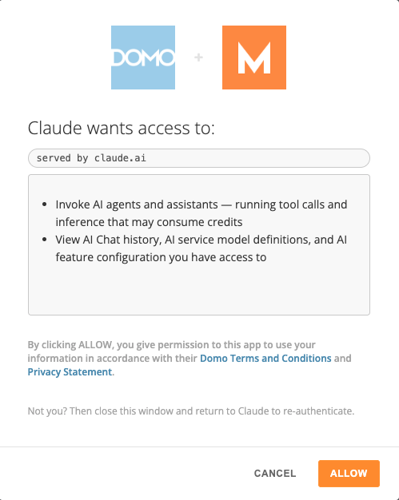
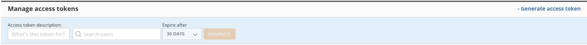

## Required Grants

To connect Claude Code to Domo's MCP Server, the following grants must be enabled for your role:

- **Use AI Services —** Access to features and Apps built using the AI Services Layer.
- **Use AI Chat —** Access to the Domo AI Assistant.
- **Use MCP —** Access to connect external AI tools to Domo's MCP Server.

Learn more about [grants](/s/article/360043438973).

## Prerequisites

- [Claude Code](https://code.claude.com/docs) installed.

- The **Domo MCP** server URL. Visit the [AI Library](/s/article/AI-Library) and retrieve the MCP server URL from the **Domo MCP** toolkit. Either URL works:

  ```
  https://<instance>.domo.com/mcp

  https://<instance>.domo.com/mcp/toolkits/domo
  ```

  <Note>**Note:** Replace `<instance>` with your actual Domo instance subdomain (for example, `mycompany` for `mycompany.domo.com`).</Note>

## Connect Claude Code

Connecting with OAuth is recommended. Use an access token only if you can't connect with OAuth.

<Tabs>
  <Tab title="OAuth">
    <Steps>
      <Step title="Add the Domo MCP Server">
        In a terminal, go to the root of your project and run the following command, replacing `<instance>` with your Domo instance subdomain:

        ```bash
        claude mcp add --transport http domo-mcp https://<instance>.domo.com/mcp
        ```

        By default, the server is available only to you, in the current project. To use it in all of your projects, add `--scope user` to the command.
      </Step>

      <Step title="Sign In to Domo">
        Start Claude Code and run `/mcp`. Select `domo-mcp`, then select **Authenticate**.

        A browser window opens to your Domo instance. Sign in with your Domo credentials, then select **Allow** on the consent screen that asks to allow Claude Code access to Domo.

        <Frame></Frame>
      </Step>

      <Step title="Verify the Connection">
        Return to Claude Code and run `/mcp` again. `domo-mcp` shows as connected.

        To test the connection, try a prompt such as "How many DataSets do I have access to?"
      </Step>
    </Steps>
  </Tab>

  <Tab title="Access Token">
    <Steps>
      <Step title="Generate an Access Token">
        In Domo, go to **Admin** > **Authentication** > **Access Tokens** and generate a token, or request one from your MajorDomo. See [Manage Access Tokens](/s/article/360042934494#manage-access-tokens) for instructions.

        <Frame></Frame>
      </Step>

      <Step title="Add the Domo MCP Server">
        In a terminal, go to the root of your project and run the following command, replacing `<instance>` with your Domo instance subdomain and `<DOMO_ACCESS_TOKEN>` with your access token:

        ```bash
        claude mcp add --transport http domo-mcp \
          https://<instance>.domo.com/mcp \
          --header "X-DOMO-DEVELOPER-TOKEN: <DOMO_ACCESS_TOKEN>"
        ```

        By default, the server is available only to you, in the current project. To use it in all of your projects, add `--scope user` to the command.

        <Warning>**Important:** Don't add `--scope project` to this command. That scope saves the server, including your access token, to a `.mcp.json` file in your project that is usually shared through source control.</Warning>

        To share the server with your team through `.mcp.json` instead, have each person store their own token in a `DOMO_ACCESS_TOKEN` environment variable and reference it in the file:

        ```json
        {
          "mcpServers": {
            "domo-mcp": {
              "type": "http",
              "url": "https://<instance>.domo.com/mcp",
              "headers": {
                "X-DOMO-DEVELOPER-TOKEN": "${DOMO_ACCESS_TOKEN}"
              }
            }
          }
        }
        ```
      </Step>

      <Step title="Verify the Connection">
        Start Claude Code and run `/mcp`. `domo-mcp` shows as connected.

        To test the connection, try a prompt such as "How many DataSets do I have access to?"
      </Step>
    </Steps>
  </Tab>
</Tabs>

<Note>**Note:** MCP tool calls don't incur AI operation charges. However, if the tool that gets called uses any of the Domo-provided models, input and output token charges can apply.</Note>

## FAQ

<AccordionGroup>
<Accordion title="Can I connect multiple Domo instances?">
Yes. Repeat the steps in this article for each instance, using a unique server name and the corresponding domain in the MCP server URL for each.
</Accordion>

<Accordion title="What data does Claude Code have access to once connected?">
Claude Code can access the data and tools exposed by the Domo MCP toolkit, which includes querying DataSets and interacting with Domo features available through the MCP API. Access is scoped to what your Domo user account is permitted to see.
</Accordion>
</AccordionGroup>

## Related Articles

- [Connect AI Tools to Domo Using MCP](/s/article/Connect-AI-Tools-to-Domo-Using-MCP)
- [Connect to the Domo MCP Server with Standard OAuth](/s/article/MCP-Standard-OAuth)
- [Manually Connect to the Domo MCP Server](/s/article/MCP-Manually-Connect)
- [Connect Claude Desktop to Domo MCP](/s/article/Connect-Claude-Desktop-to-Domo-MCP)
