## Required Grants

To connect Claude Desktop to Domo's MCP Server, the following grants must be enabled for your role:

- **Use AI Services —** Access to features and Apps built using the AI Services Layer.
- **Use AI Chat —** Access to the Domo AI Assistant.
- **Use MCP —** Access to connect external AI tools to Domo's MCP Server.

Learn more about [grants](/s/article/360043438973).

## Prerequisites

- The [Claude Desktop](https://claude.ai/download) app.

- The **Domo MCP** server URL. Visit the [AI Library](/s/article/AI-Library) and retrieve the MCP server URL from the **Domo MCP** toolkit. Either URL works:

  ```
  https://<instance>.domo.com/mcp

  https://<instance>.domo.com/mcp/toolkits/domo
  ```

  <Note>**Note:** Replace `<instance>` with your actual Domo instance subdomain (for example, `mycompany` for `mycompany.domo.com`).</Note>

  <Frame>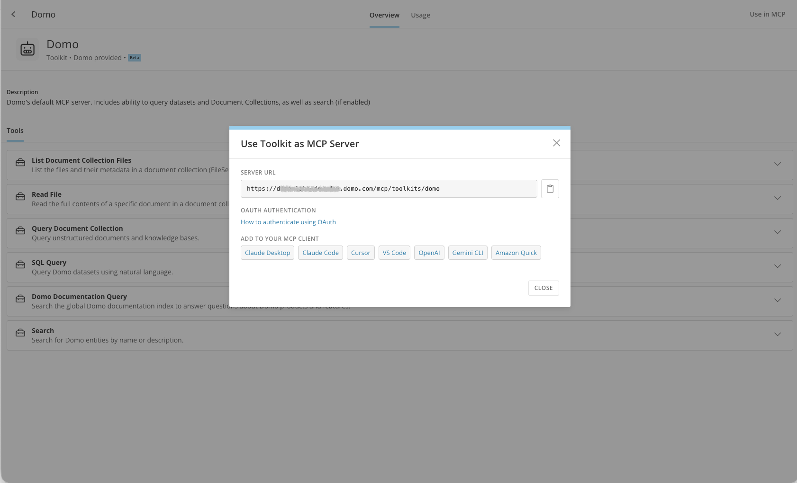</Frame>

## Connect Claude Desktop

Claude Desktop natively supports remote MCP servers, so connecting with OAuth is recommended. Use an access token only if you can't connect with OAuth.

<Tabs>
  <Tab title="OAuth">
    <Steps>
      <Step title="Add a Custom Connector">
        In Claude Cowork or Chat, select **Customize** on the left sidebar of the Claude Desktop app.

        <Frame>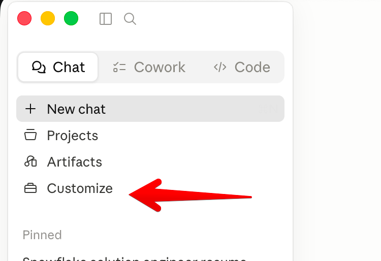</Frame>

        Select **Connectors** to link third-party applications, like remote MCP servers, to Claude.

        <Frame>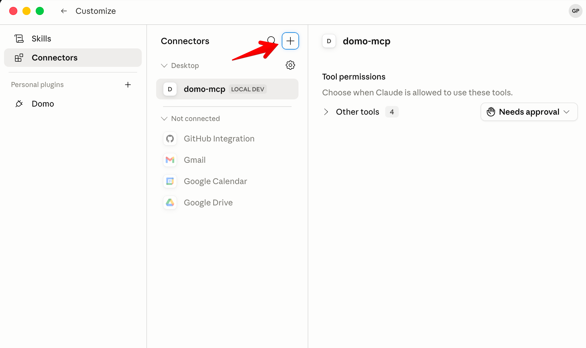</Frame>

        Give the MCP server a name, paste the **Domo MCP** URL into the **Remote MCP server URL** field, and select **Add**.

        <Frame>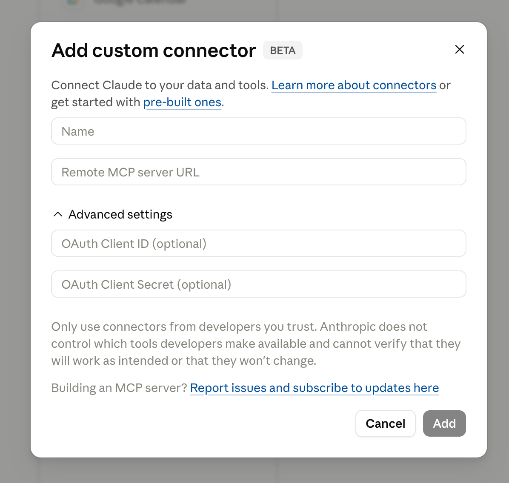</Frame>
      </Step>

      <Step title="Sign In to Domo">
        Select **Connect** on the new connector.

        <Frame>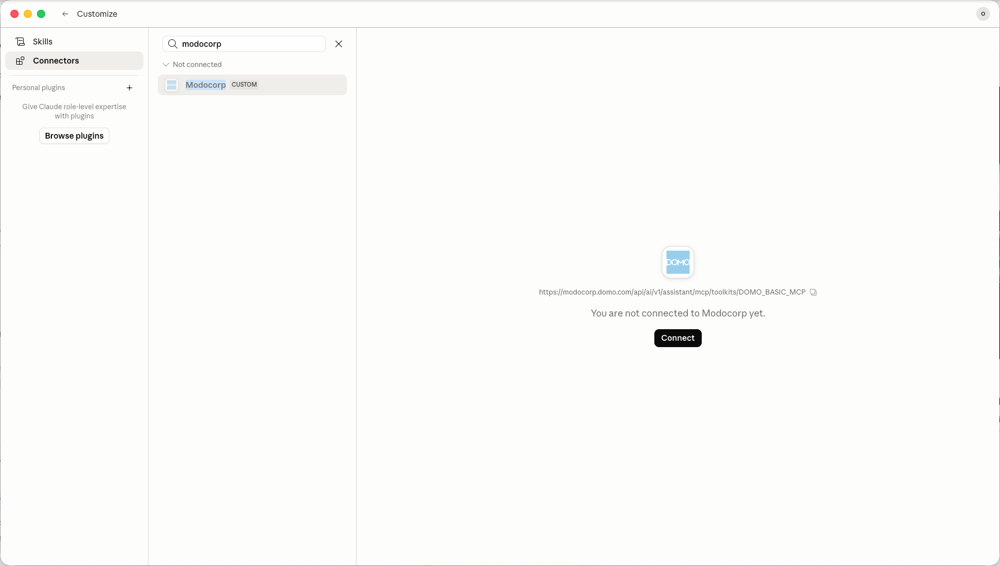</Frame>

        On the Domo sign-in page, select **Sign In** and log in with your Domo credentials.

        <Frame>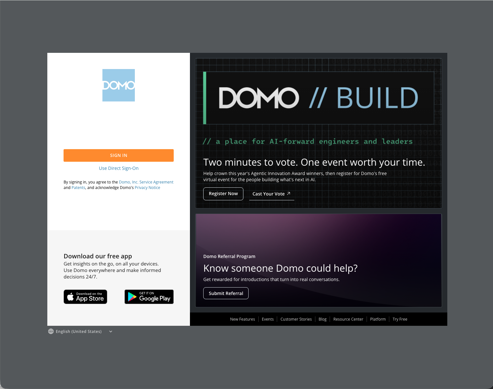</Frame>
      </Step>

      <Step title="Allow Claude to Access Domo">
        On the consent screen that asks to allow Claude access to Domo, select **Allow**.

        <Frame></Frame>

        When the **Connected** confirmation displays, select **Open desktop app** to return to Claude Desktop.

        <Frame>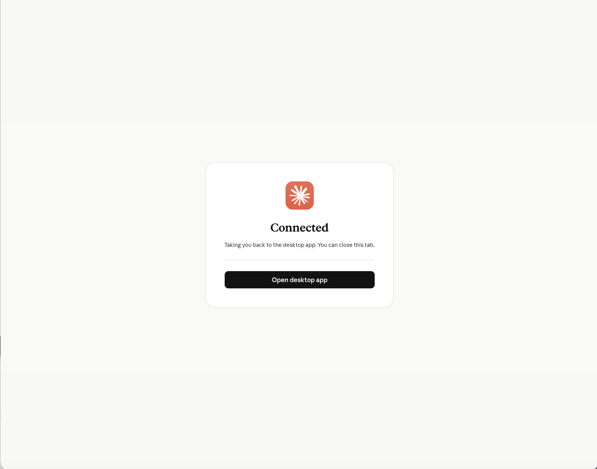</Frame>
      </Step>

      <Step title="Set Tool Permissions">
        The connector is now active and Claude has access to your Domo instance. From the connector's **Tool permissions**, choose when Claude is allowed to use each tool.

        <Frame>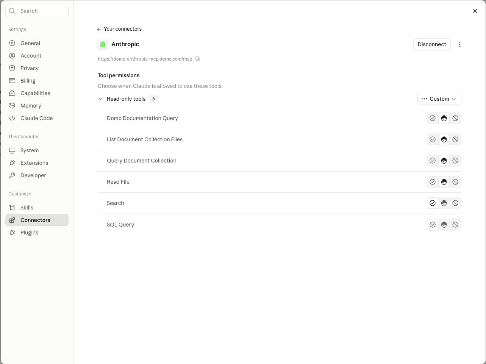</Frame>
      </Step>
    </Steps>
  </Tab>

  <Tab title="Access Token">
    This method runs the [mcp-remote](https://www.npmjs.com/package/mcp-remote) package on your computer to pass your access token to Domo, so it requires **Node.js** version 21 or higher. Use [nvm](https://github.com/nvm-sh/nvm) to manage your Node.js version.

    <Steps>
      <Step title="Generate an Access Token">
        In Domo, go to **Admin** > **Authentication** > **Access Tokens** and generate a token, or request one from your MajorDomo. See [Manage Access Tokens](/s/article/360042934494#manage-access-tokens) for instructions.

        <Frame></Frame>
      </Step>

      <Step title="Install mcp-remote">
        Open a terminal and run:

        ```bash
        npm install mcp-remote
        ```
      </Step>

      <Step title="Open the Claude Desktop Configuration">
        In Claude Desktop, go to **Settings** > **Developer** and select **Edit Config**.

        <Frame>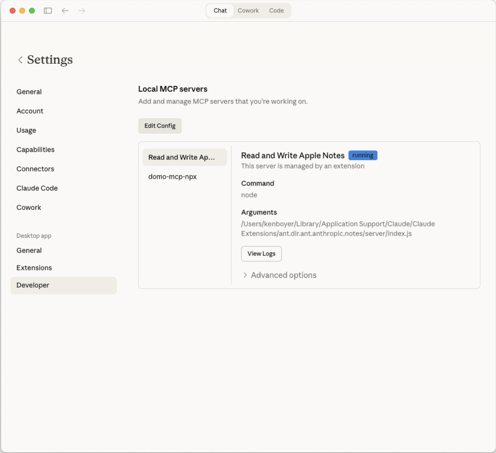</Frame>

        This opens `claude_desktop_config.json`, located at:

        - **Mac —** `/Users/<username>/Library/Application Support/Claude/claude_desktop_config.json`
        - **Windows —** `%APPDATA%\Claude\claude_desktop_config.json`

        <Frame>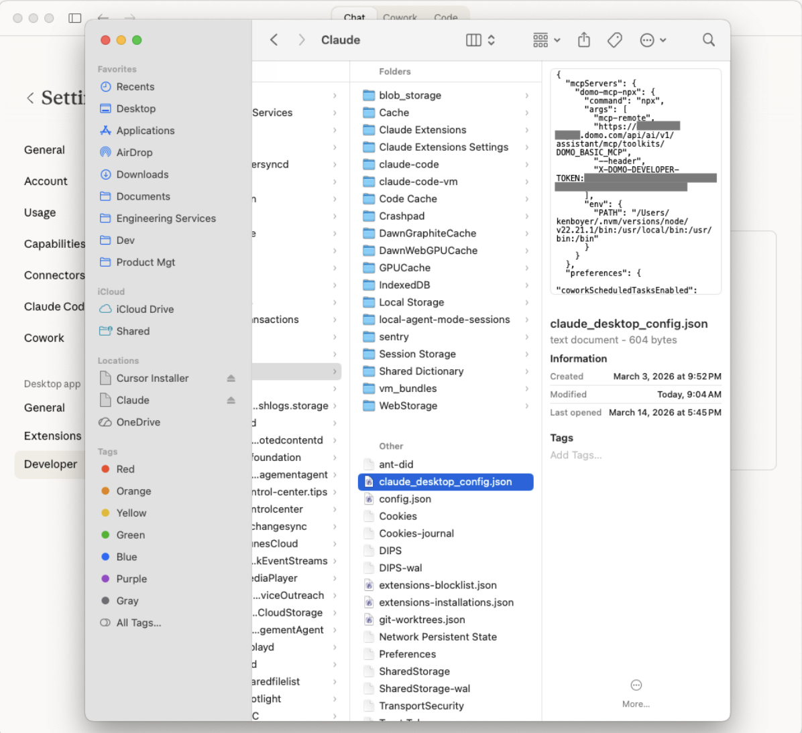</Frame>
      </Step>

      <Step title="Add the Domo MCP Server">
        Add the following to the configuration file, replacing `<instance>` with your Domo instance subdomain and `<DOMO_ACCESS_TOKEN>` with your access token:

        ```json
        {
          "mcpServers": {
            "domo-mcp-npx": {
              "command": "npx",
              "args": [
                "mcp-remote",
                "https://<instance>.domo.com/mcp",
                "--header",
                "X-DOMO-DEVELOPER-TOKEN:<DOMO_ACCESS_TOKEN>"
              ]
            }
          }
        }
        ```

        <Note>**Note:** If the file already has an `mcpServers` object, add only the `domo-mcp-npx` entry inside it, separated from the other servers by a comma.</Note>

        Save the file, then quit and restart Claude Desktop for the configuration to take effect.

        <Frame>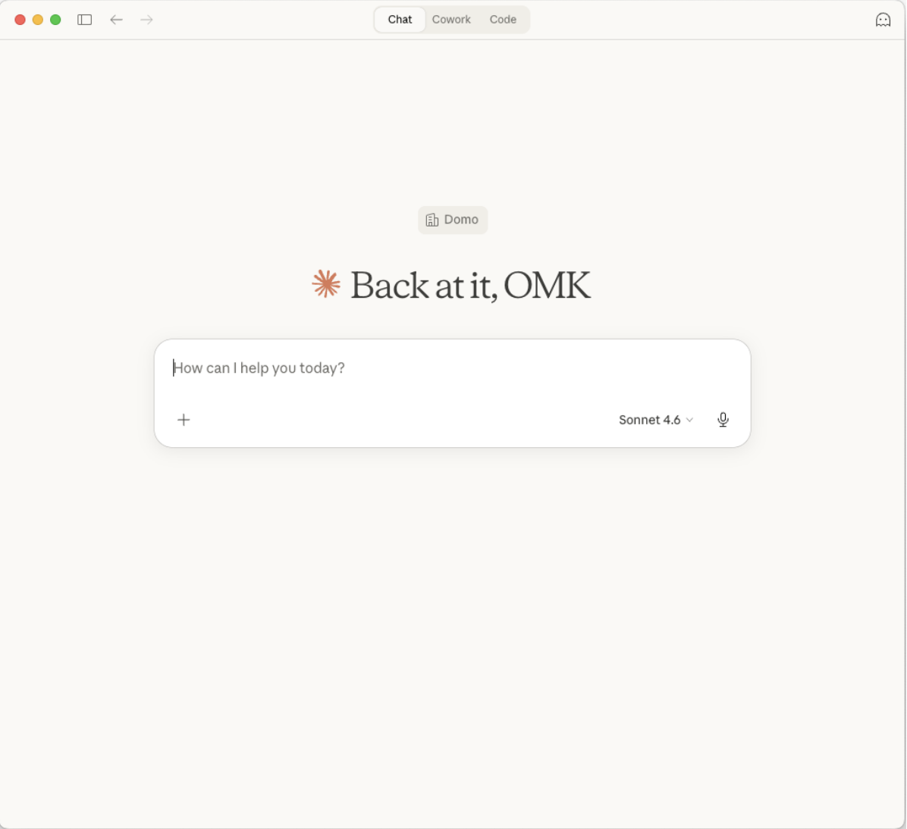</Frame>
      </Step>

      <Step title="Verify the Connection">
        Select **Customize** > **Connectors** and confirm the Domo MCP server is listed and connected.

        <Frame>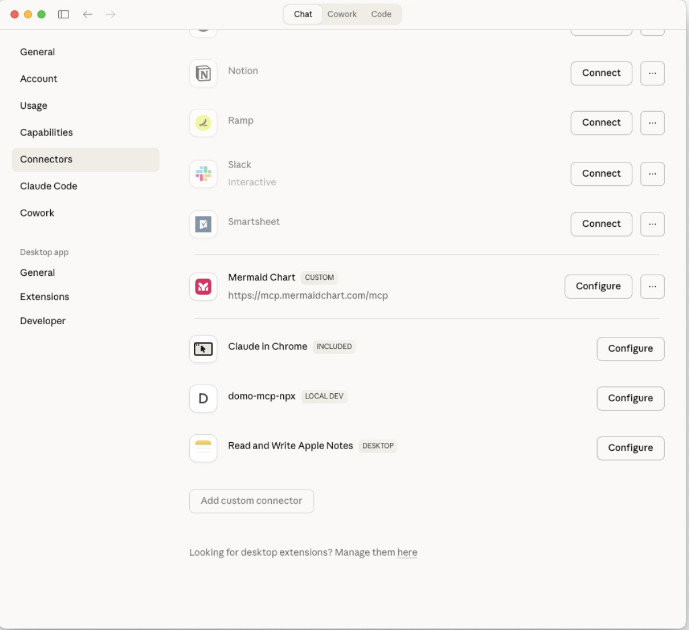</Frame>

        Select the server to view its tool permissions. You should see the following tools listed:

        - `List Document Collection Files`
        - `Domo Documentation Query`
        - `SQL Query`
        - `Query Document Collection`
        - `Read File`
        - `Search`

        <Frame>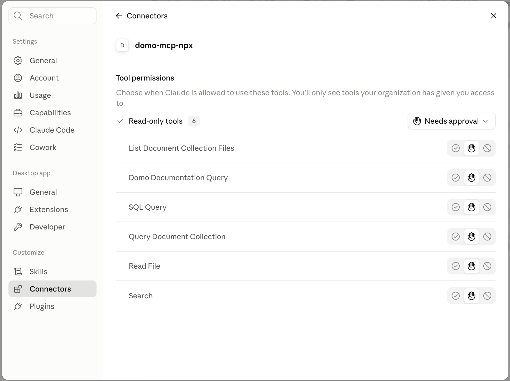</Frame>

        To test the connection, try a prompt such as "How many DataSets do I have access to?"

        <Frame>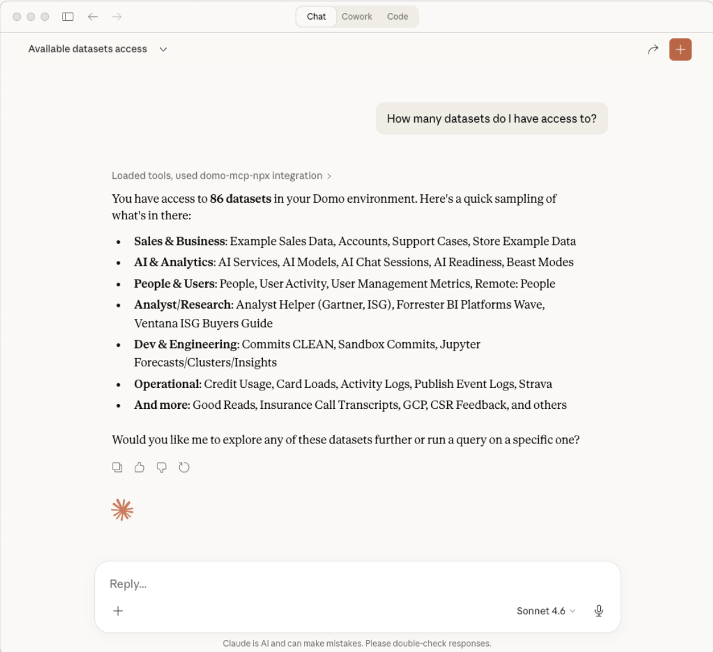</Frame>
      </Step>
    </Steps>
  </Tab>
</Tabs>

<Note>**Note:** MCP tool calls don't incur AI operation charges. However, if the tool that gets called uses any of the Domo-provided models, input and output token charges can apply.</Note>

## FAQ

<AccordionGroup>
<Accordion title="Can I connect multiple Domo instances?">
Yes. Repeat the steps in this article for each instance, using a unique connector name and the corresponding domain in the MCP server URL for each.
</Accordion>

<Accordion title="What data does Claude have access to once connected?">
Claude can access the data and tools exposed by the Domo MCP toolkit, which includes querying DataSets and interacting with Domo features available through the MCP API. Access is scoped to what your Domo user account is permitted to see.
</Accordion>

<Accordion title="Claude Desktop can't find npx when I connect with an access token. How do I fix it?">
On Mac, add an `env` property to the `domo-mcp-npx` server entry in your configuration, replacing `<USER_PATH>` with your home directory path:

```json
"env": {
  "PATH": "<USER_PATH>/.nvm/versions/node/v22.21.1/bin:/usr/local/bin:/usr/bin:/bin"
}
```

On Windows, replace the `"command"` value in your configuration with the full path to the `npx` executable, for example:

```json
"command": "C:\\Program Files\\nodejs\\npx.cmd"
```
</Accordion>
</AccordionGroup>

## Related Articles

- [Connect AI Tools to Domo Using MCP](/s/article/Connect-AI-Tools-to-Domo-Using-MCP)
- [Connect to the Domo MCP Server with Standard OAuth](/s/article/MCP-Standard-OAuth)
- [Manually Connect to the Domo MCP Server](/s/article/MCP-Manually-Connect)
- [Connect Claude Code to Domo MCP](/s/article/Connect-Claude-Code-to-Domo-MCP)
