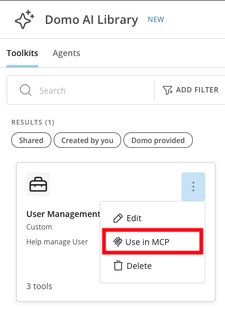
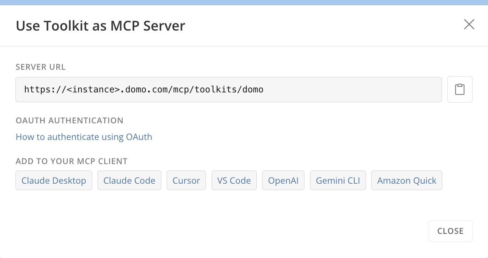
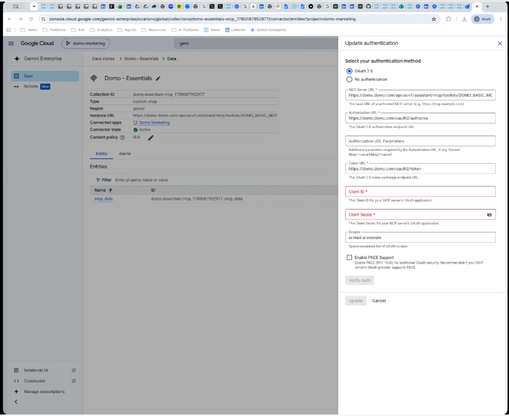

## Required Grants

To connect Gemini Enterprise to Domo's MCP Server, the following grants must be enabled for your role:

- **Use AI Services —** Access to features and Apps built using the AI Services Layer.
- **Use AI Chat —** Access to the Domo AI Assistant.
- **Use MCP —** Access to connect external AI tools to Domo's MCP Server.

Learn more about [grants](/s/article/360043438973).

## Prerequisites

- A Toolkit in the [AI Library](/s/article/AI-Library) that you want to expose to Gemini Enterprise.
- Admin access in Domo to create an OAuth client and generate an access token.
- Access to the Google Cloud Console with permission to create data stores in your Gemini Enterprise app.

<Note>**Note:** A custom MCP data store can be shared by every user in your Gemini Enterprise app. Only one person needs to complete this setup — the rest of your organization doesn't need to create its own data store.</Note>

The custom MCP data store lets you integrate Domo Toolkits, as well as other MCP-compliant third-party systems, directly into Gemini Enterprise. This gives your Gemini Enterprise agents access to business-critical information and specialized logic within your Domo instance when a standard connector isn't available.

## Connect Gemini Enterprise

Gemini Enterprise authenticates to your Toolkit's MCP server using an OAuth 2.0 Client ID and Secret, which you register in Domo before configuring the data store.

<Steps>
  <Step title="Copy Your Toolkit's MCP Server URL">
    From the **AI Library**, select the **Toolkits** tab and find the Toolkit you want to expose. Select the action menu on the Toolkit and choose **Use in MCP**.

    <Frame></Frame>

    Copy the **Server URL**. You'll paste this into Gemini Enterprise in a later step.

    <Frame></Frame>
  </Step>

  <Step title="Generate a Domo Access Token">
    Generate a Domo access token. See [Manage Access Tokens](/s/article/360042934494) for instructions. You use this token only to register the OAuth client in the next step.

    <Tip>**Tip:** Set the access token's time to live to at least one year so you don't need to regenerate it and update the data store again soon after.</Tip>
  </Step>

  <Step title="Register an OAuth Client in Domo">
    Open a terminal and run the following curl command, replacing `<DOMAIN>` with your Domo instance domain and `<ACCESS_TOKEN>` with the token you generated:

    ```bash
    curl -i -X POST \
      "https://<DOMAIN>/oauth2/admin/clients" \
      -H "X-DOMO-Developer-Token: <ACCESS_TOKEN>" \
      -H "Content-Type: application/json" \
      -d '{
        "client_name": "Gemini Enterprise MCP",
        "redirect_uris": ["https://vertexaisearch.cloud.google.com/oauth-redirect"],
        "grant_types": ["refresh_token", "authorization_code"],
        "token_endpoint_auth_method": "client_secret_post",
        "scope": "ai:read ai:execute"
      }'
    ```

    <Note>**Note:** You can also authenticate this request with a browser session cookie instead of an access token by sending `X-DOMO-Authentication: <SESSION>`, where `<SESSION>` is the value of the `DA-SID-xxx-xxx-xxx-xxx` cookie (found under **Developer Tools > Network > Headers > Cookie** in your browser). An access token is recommended since it doesn't require you to stay signed in.</Note>

    The response includes a `client_id` and `client_secret`. Copy both values — you'll need them to configure the data store in Google Cloud.
  </Step>

  <Step title="Create a Custom MCP Server Data Store">
    Open the [Google Cloud Console](https://console.cloud.google.com) and go to the **Gemini Enterprise** page. Select **Data stores**, then select **Create data store** and search for **Custom MCP Server**.
  </Step>

  <Step title="Configure the Endpoint and Save">
    Under **Configure Endpoint**, enter the **Server URL** you copied in the first step, then select **OAuth 2.0** as the authentication method and enter the following:

    - **Authorization URL —** `https://<DOMAIN>/oauth2/authorize`
    - **Token URL —** `https://<DOMAIN>/oauth2/token`
    - **Client ID** and **Client Secret —** From the curl response in the previous step.
    - **Scopes —** `ai:read ai:execute`

    <Note>**Note:** The **No authentication** option is only available if your MCP endpoint doesn't require credentials. It doesn't apply to a Domo Toolkit MCP server.</Note>

    <Frame></Frame>

    Under **Manage Governance**, optionally control traffic and egress routing through the **Agent Gateway** and other advanced options. Then select **Save** (or **Update**, if you're editing an existing data store).
  </Step>
</Steps>

<Note>**Note:** If the tool your Gemini Enterprise agent calls uses a Domo-provided AI model, input and output token charges may apply.</Note>

## FAQ

<AccordionGroup>
<Accordion title="Does each user need to create a Google Data Store?">
No. All users can share a single Google Data Store.
</Accordion>

<Accordion title="Can I connect to an existing data store?">
Connecting to an existing data store isn't supported. You must create and register a new custom MCP server data store directly within your Gemini Enterprise app.
</Accordion>
</AccordionGroup>

## Related Articles

- [AI Library](/s/article/AI-Library)
- [Connect AI Tools to Domo Using MCP](/s/article/Connect-AI-Tools-to-Domo-Using-MCP)
- [Connect Amazon Quick Suite to Domo MCP](/s/article/Connect-Amazon-Quick-Suite-To-Domo-MCP)
- [Connect Claude Desktop to Domo MCP](/s/article/Connect-Claude-Desktop-to-Domo-MCP)
- [Manage Access Tokens](/s/article/360042934494)
