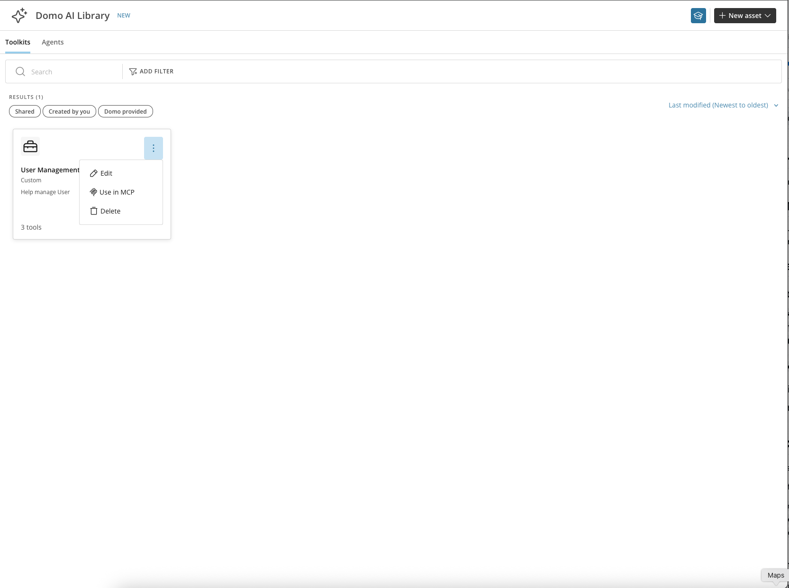
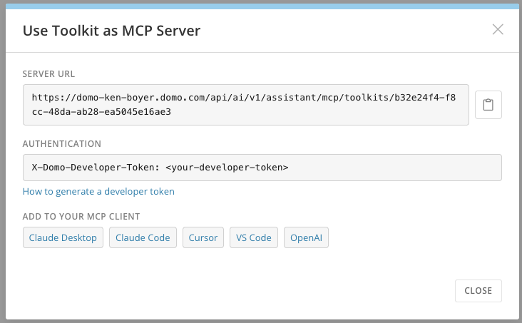
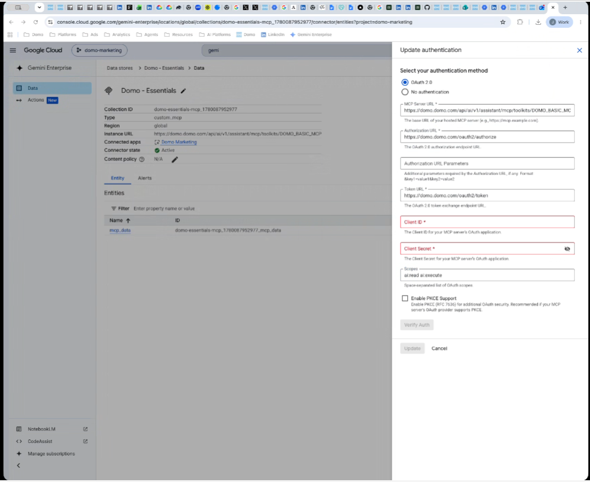

import { BetaNote } from '/snippets/BetaNote.mdx';

## Intro

This article explains how to connect Google Gemini Enterprise to Domo's MCP Server using a custom MCP data store, letting Gemini Enterprise securely access your Domo AI Library Toolkits and the private data behind them.

---

## Required Grants

To connect Gemini Enterprise to Domo's MCP Server, the following grants must be enabled for your role:

- **Use AI Services —** Access to features and Apps built using the AI Services Layer.
- **Use AI Chat —** Access to the Domo AI Assistant.
- **Use MCP —** Access to connect external AI tools to Domo's MCP Server.

Learn more about [grants](/s/article/360043438973).

## Prerequisites

- A Toolkit in the [AI Library](/s/article/AI-Library) that you want to expose to Gemini Enterprise.
- Admin access in Domo to create an OAuth client and generate an access token.
- Access to the Google Cloud Console with permission to create data stores in your Gemini Enterprise app.

<Note>**Note:** A custom MCP data store can be shared by every user in your Gemini Enterprise app. Only one person needs to complete this setup — the rest of your organization doesn't need to create its own data store.</Note>

The custom MCP data store lets you integrate Domo Toolkits, as well as other MCP-compliant third-party systems, directly into Gemini Enterprise. This gives your Gemini Enterprise agents access to business-critical information and specialized logic within your Domo instance when a standard connector isn't available.

## Get Your Toolkit's MCP Server Details

1. From the **AI Library**, select the **Toolkits** tab and find the Toolkit you want to expose.
2. Select the action menu on the Toolkit and choose **Use in MCP**.

   <Frame></Frame>

3. Copy the **Server URL**. You'll paste this into Gemini Enterprise in a later step.

   <Frame></Frame>

## Create a Domo Client ID and Secret

Gemini Enterprise authenticates to your Toolkit's MCP server using an OAuth Client ID and Secret. Create one before configuring the data store, using the Domo UI (preferred) or the API.

### Create the Client in the UI <Badge>Beta</Badge>

<BetaNote />

1. In Domo, go to **Admin** > **Authentication** > **API Clients** and create an OAuth 2.1 client. See [Manage API Clients](/s/article/000005240#create-an-oauth-21-client-beta) for the full steps.
2. For **Redirect URIs**, enter `https://vertexaisearch.cloud.google.com/oauth-redirect`.
3. Under **Scopes**, select **ai:read** and **ai:execute**. Both are required.
4. Select **Create**, then copy the client ID and secret — you'll need them to configure the data store in Google Cloud.

### Create the Client with the API

1. Generate a Domo access token. See [Manage Access Tokens](/s/article/360042934494) for instructions.

2. Open a terminal and run the following curl command, replacing `<DOMAIN>` with your Domo instance domain and `<ACCESS_TOKEN>` with the token you generated:

   ```bash
   curl -i -X POST \
     "https://<DOMAIN>/oauth2/admin/clients" \
     -H "X-DOMO-Developer-Token: <ACCESS_TOKEN>" \
     -H "Content-Type: application/json" \
     -d '{
       "client_name": "Gemini Enterprise MCP",
       "redirect_uris": ["https://vertexaisearch.cloud.google.com/oauth-redirect"],
       "grant_types": ["refresh_token", "authorization_code"],
       "token_endpoint_auth_method": "client_secret_post",
       "scope": "ai:read ai:execute"
     }'
   ```

3. The response includes a `client_id` and `client_secret`. Copy both values — you'll need them to configure the data store in Google Cloud.

## Configure the Data Store in Google Cloud

1. Open the [Google Cloud Console](https://console.cloud.google.com) and go to the **Gemini Enterprise** page.
2. Select **Data stores**, then select **Create data store** and search for **Custom MCP Server**.
3. Under **Configure Endpoint**, enter the **Server URL** you copied in [Get Your Toolkit's MCP Server Details](#get-your-toolkits-mcp-server-details), then select an authentication method:

   - **OAuth 2.0** (recommended) — enter the following:
     - **Authorization URL —** `https://<DOMAIN>/oauth2/authorize`
     - **Token URL —** `https://<DOMAIN>/oauth2/token`
     - **Client ID** and **Client Secret —** from the curl response in the previous step.
     - **Scopes —** `ai:read ai:execute`
   - **No authentication** — only available if your MCP endpoint doesn't require credentials. This doesn't apply to a Domo Toolkit MCP server.

   <Frame></Frame>

4. Under **Manage Governance**, optionally control traffic and egress routing through the **Agent Gateway** and other advanced options.
5. Select **Save** (or **Update**, if you're editing an existing data store).

<Note>**Note:** If the tool your Gemini Enterprise agent calls uses a Domo-provided AI model, input and output token charges may apply.</Note>

## FAQ

<AccordionGroup>

<Accordion title="Does each user need to create a Google Data Store?">
  No. All users can share a single Google Data Store.
</Accordion>

<Accordion title="Can I connect to an existing data store?">
  Connecting to an existing data store isn't supported. You must create and register a new custom MCP server data store directly within your Gemini Enterprise app.
</Accordion>

</AccordionGroup>

## Related Articles

- [AI Library](/s/article/AI-Library)
- [Connect AI Tools to Domo Using MCP](/s/article/Connect-AI-Tools-to-Domo-Using-MCP)
- [Connect Amazon Quick Suite to Domo MCP](/s/article/Connect-Amazon-Quick-Suite-To-Domo-MCP)
- [Manage Access Tokens](/s/article/360042934494)
