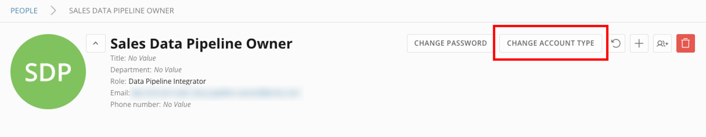
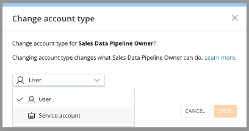
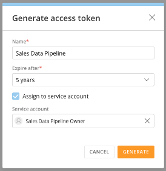

import { BetaNote } from '/snippets/BetaNote.mdx';

<BetaNote />

## Intro

A service account is an API-only identity in Domo that cannot log in to the user interface and exists to hold access tokens for integrations and automations.

This article explains how to convert a user into a service account, issue an access token to a service account, and convert a service account back to a user.

---

## Required Grants

To create and manage service accounts, the following grants must be enabled for your role:

- **Manage All Users —** Create, edit, and delete any user and reset their password.
- **Manage All Roles —** Create, edit, and delete custom roles and assign roles to users.

To issue an access token to a service account, your role must also include one of the following grants:

- **Create Access Tokens —** Generate, list, and revoke access tokens you own.
- **Manage all access tokens and API clients —** Generate access tokens and list and revoke any access token owned by any user.

Learn more about [grants](/s/article/360043438973).

## Change Account Type

Domo supports two account types: user and service account. You convert between them from a person's detail page. The two types differ in the following ways:

| Capability                        | User               | Service account                                                               |
| --------------------------------- | ------------------ | ----------------------------------------------------------------------------- |
| Log in to the Domo user interface | Yes                | No (API-only)                                                                 |
| Elevation for sensitive changes   | Required           | Bypassed                                                                      |
| Activity Log attribution          | The person         | The service account                                                           |
| Access tokens                     | Tied to the person | Owned by the service account and unaffected when the creator's access changes |

Changing an account's type changes what the account can do:

- **User to service account:** the account can no longer log in to the Domo user interface, its actions are attributed to the service account in the Activity Log, and it can bypass the elevation prompt that applies to users making sensitive changes. You can then issue access tokens to it.
- **Service account to user:** the account can log in to the Domo user interface again and can no longer bypass elevation. Access tokens the account owns are unaffected.

## Convert a User to a Service Account

Service accounts are created by converting an existing user account. Follow these steps:

1. From the navigation header, select **More** > **Admin**.
   The Admin Settings display.
2. Under **Governance**, select **People**.
   The list of people in your instance displays.
3. Select the user you want to convert.
   The person's detail page displays.
4. Select **Change Account Type**.

   <Frame>
     
   </Frame>

   The **Change account type** dialog displays.
5. In the account type list, select **Service account**.

   <Frame>
     
   </Frame>

6. Select **Save**.

A service account is a distinct identity from the user who created it, so you can give it a role, permissions, and personalized data permissions (PDP) scoped to only what the automation needs, commonly more restrictive than your own access. Learn more about [roles and grants](/s/article/360043438973).

## Issue an Access Token to a Service Account

An access token is assigned to a service account when the token is created. Follow these steps:

1. From the navigation header, select **More** > **Admin**.
   The Admin Settings display.
2. Under **Authentication**, select **Access tokens**.
   The **Manage access tokens** page displays.
3. Select **Generate access token**.
4. In the **Name** field, enter a name for the token. Use a name that helps you identify the token's purpose later.
5. In the **Expire after** field, select the lifespan of the token.
6. Select **Assign to service account**.
   The **Service account** field displays.
7. In the **Service account** field, select the service account the token is for.

   <Frame>
     
   </Frame>

8. Select **Generate**.
9. Copy the token and store it somewhere secure. The token does not display again after you close this dialog.

<Warning>**Important:** Treat access tokens like a password: Do not share them, hard-code them in scripts, or commit them to version control, and guard them according to your organization's security policies. An access token grants the same level of access as the service account it belongs to; if the service account's permissions change, the token's access level changes accordingly.</Warning>

<Note>**Note:** Access tokens bind to the service account, not to the person who created them, so they keep working even if that person changes roles or leaves. The creator is recorded for audit only.</Note>

Learn more about [managing access tokens](/s/article/Access-Tokens).

## Convert a Service Account Back to a User

You can convert a service account back to a regular user at any time. Changing the account type has no effect on the access tokens the account owns.

1. From the navigation header, select **More** > **Admin**.
   The Admin Settings display.
2. Under **Governance**, select **People**.
   The list of people in your instance displays.
3. Select the service account you want to convert.
   The account's detail page displays.
4. Select **Change Account Type**.
   The **Change account type** dialog displays.
5. In the account type list, select **User**.
6. Select **Save**.

## FAQ

<AccordionGroup>

<Accordion title="Can a service account log in to Domo?">
  No. A service account is API-only; logging in to the user interface is blocked by design.
</Accordion>

<Accordion title="Who can create and use service accounts?">
  Only administrators with both the **Manage All Users** and **Manage All Roles** grants. Delegating use to non-administrators may come in a later release.
</Accordion>

<Accordion title="Who can assign access tokens to service accounts?">
  A user must have the grants required to create access tokens — either **Create Access Tokens** or **Manage all access tokens and API clients** — and must also have both the **Manage All Users** and **Manage All Roles** grants.
</Accordion>

<Accordion title="What happens to a service account's access tokens if the person who created them leaves or loses access?">
  Nothing. Access tokens bind to the service account, not to the creator, so they keep working. The creator is recorded for audit only.
</Accordion>

<Accordion title="Does a service account get the same access I have?">
  No. You give it a role, permissions, and personalized data permissions (PDP) that are commonly more restrictive than your own, following the principle of least privilege.
</Accordion>

<Accordion title="What happens to its access tokens when I delete a service account?">
  Deleting a service account immediately revokes all access tokens it owns.
</Accordion>

</AccordionGroup>
