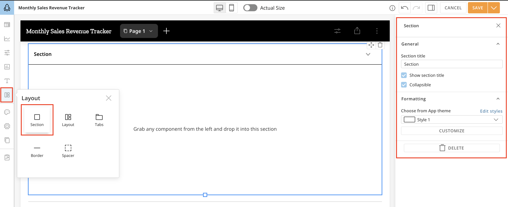
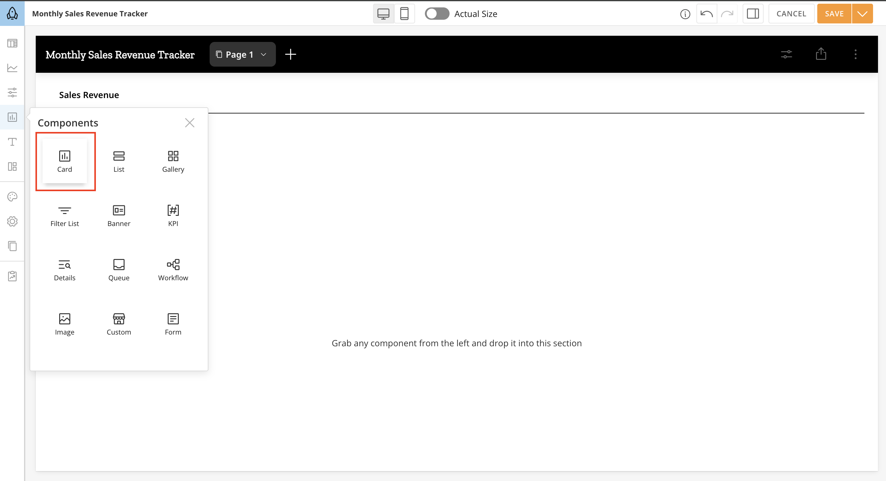
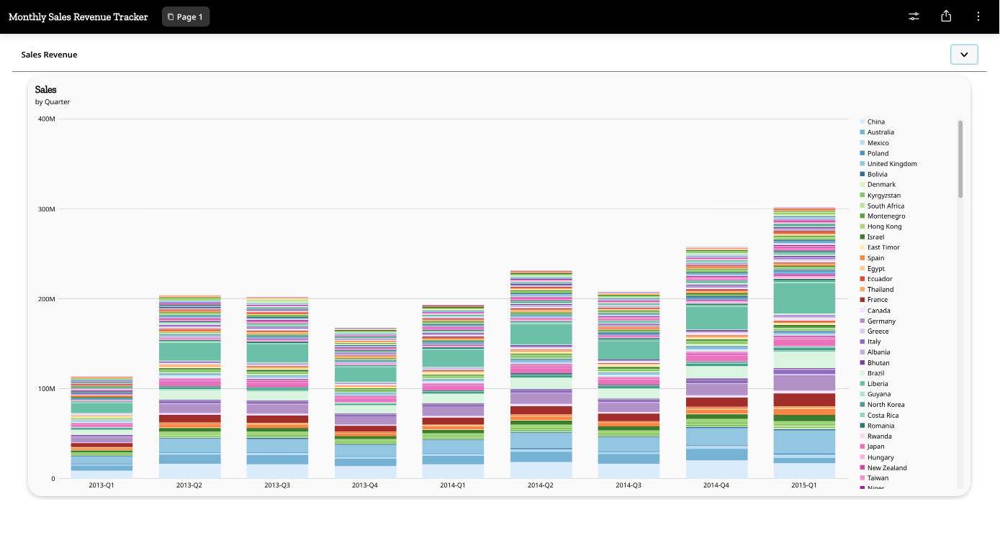
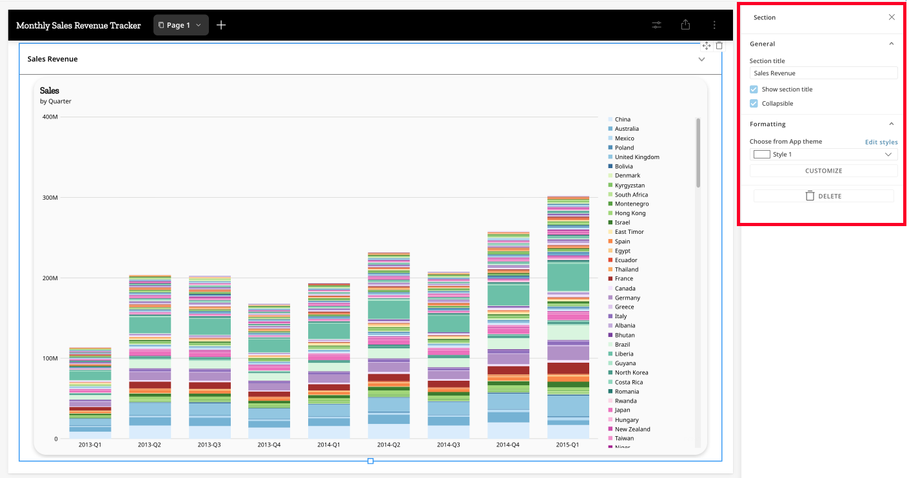
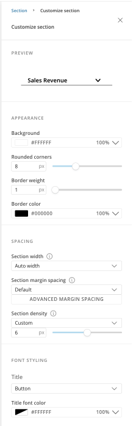
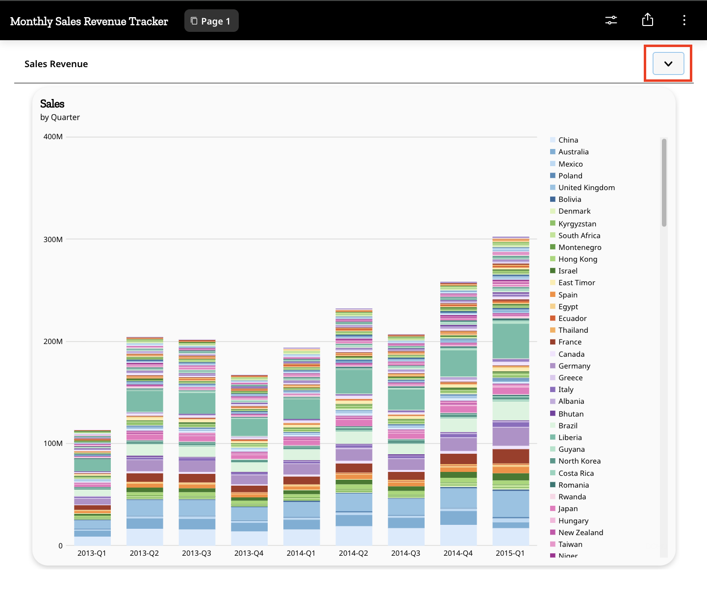
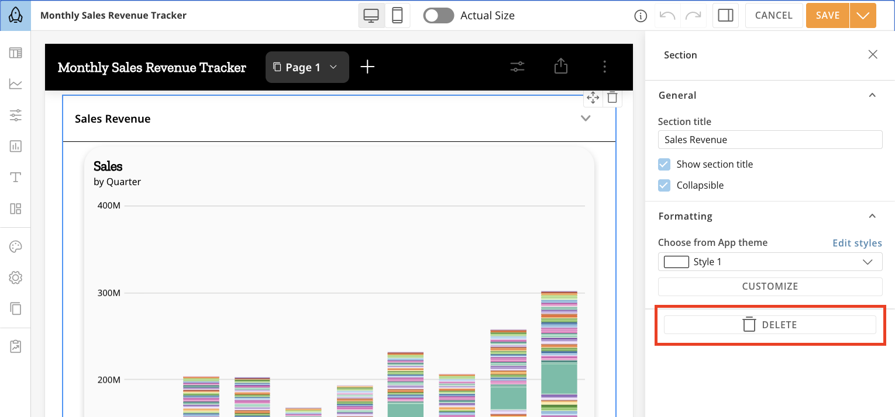
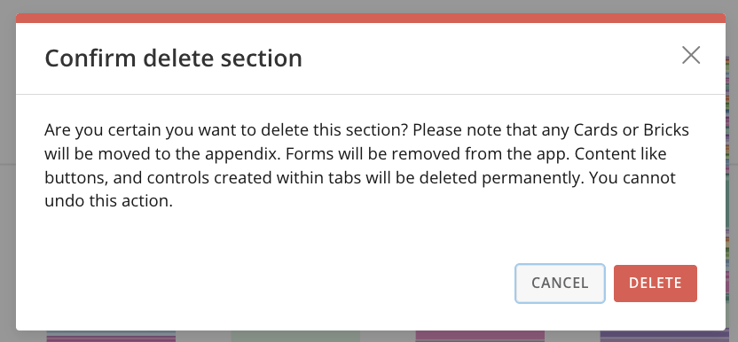

## Intro

This article explains how to add a Section to an App Studio page, add content to it, configure and format it, move it, and delete it.

Sections are labeled containers that group related content into named, visually distinct areas of an App Studio page. Viewers can collapse and expand Sections.

---

## Required Grants

To access Sections, the following grants must be enabled for your role:

- **Edit App (App Studio) —** Allows you to edit App Studio pages within App Studio.
- **Edit Cards —** Allows you to edit Cards in Domo.

Learn more about [grants](/s/article/360043438973).

## Access Sections

Access Sections from the **Layout** menu in the left navigation of the App Studio app editor.

Learn how to [edit an app](/s/article/000005295#edit-an-app).

## Add a Section

1. In the left navigation of the App Studio app editor, select **Layout**.  
   The **Layout** menu opens.
2. Select **Section**.  
   A new Section is added to the editor canvas, and the **Section** panel opens on the right.

<Frame>
  
</Frame>

## Add Content to a Section

1. In the left navigation, select the menu that contains the component you want to add, such as **Charts** or **Components**.
2. Drag the component and drop it into the Section on the canvas.  
   The component displays inside the Section.

<Frame>
  
</Frame>
<Frame>
  
</Frame>

## Configure a Section

1. On the canvas, select the Section.  
   The **Section** panel opens on the right.
2. In the **General** area, enter a **Section title**.  
   New Sections are titled "Section" by default.
3. (Optional) Clear **Show section title** to hide the title on the Section.  
   **Show section title** is checked by default.
4. (Optional) Clear **Collapsible** to prevent viewers from collapsing and expanding the Section.  
   **Collapsible** is checked by default. When it's checked, a caret icon <i className="icon-caret-down" aria-hidden="true" /> displays at the right edge of the Section header.

<Frame>
  
</Frame>

## Format a Section

1. On the canvas, select the Section.  
   The **Section** panel opens on the right.
2. In the **Formatting** area, choose a predefined format from the **Choose from App theme** dropdown. **Style 1** is the predefined option.
3. (Optional) Select **Edit styles** to adjust and configure your style template.
4. (Optional) Select **Customize** to edit the Section's styles.  
   The customization options open in the right panel.
5. (Optional) Change any of the following options:
   - **Preview —** Displays the Section.
   - **Appearance —** Change or adjust the background, rounded corners, border weight, and border color.
   - **Spacing —** Change or adjust the section width, section margin spacing, advanced margin spacing, and section density.
   - **Font Styling —** Change or adjust the title style and title font color.

<Frame>
  
</Frame>

## Move a Section

1. On the canvas, select the Section.  
   A toolbar displays at the top-right corner of the Section.
2. Drag the move icon <i className="icon-arrows-fourway" aria-hidden="true" /> and drop the Section in its new position on the page.

## Collapse and Expand a Section

Sections start expanded. When **Collapsible** is checked for a Section (the default), viewers can collapse it to hide its content and expand it to show the content again. Domo remembers whether a viewer collapsed or expanded each Section the next time they visit.

1. In the app, select the caret icon <i className="icon-caret-down" aria-hidden="true" /> at the right edge of the Section header.  
   The Section collapses and hides its content.
2. Select the caret icon again.  
   The Section expands and shows its content.

<Frame>
  
</Frame>

## Delete a Section

<Warning>**Important:** Deleting a Section moves any cards or Domo Bricks in the Section to the appendix. Forms are removed from the app, and buttons and controls are permanently deleted. You can't undo this action.</Warning>

1. On the canvas, select the Section.  
   The **Section** panel opens on the right.

   <Frame>
     
   </Frame>

2. Select **Delete**.  
   The **Confirm delete section** dialog displays the following message: "Are you certain you want to delete this section? Please note that any Cards or Bricks will be moved to the appendix. Forms will be removed from the app. Content like buttons, and controls created within tabs will be deleted permanently. You cannot undo this action."

   <Frame>
     
   </Frame>

3. Select **Delete** to confirm.  
   The Section is removed from the page.

## FAQ

<AccordionGroup>

<Accordion title="Can I add a Section inside another Section?">
No. Sections support one level of hierarchy only.
</Accordion>

<Accordion title="Do Sections change who can see the cards inside them?">
No. Cards within a Section retain their existing permissions. Sections don't add Section-level data filtering or Personalized Data Permissions (PDP).
</Accordion>

<Accordion title="Can I use Sections on Standard Pages or dashboards?">
No. Sections are available in App Studio only.
</Accordion>

<Accordion title="Do Sections replace Collections on Standard Pages?">
Yes. Sections are the modern, supported replacement for the Collections feature on Standard Pages. Existing Standard Pages aren't migrated automatically, so you need to recreate the layout in App Studio and use Sections to replicate the grouping structure.
</Accordion>

</AccordionGroup>

## Related Articles

- [App Studio | Overview](/s/article/000005295)
- [Create and Customize App Components in App Studio](/s/article/000005864)
