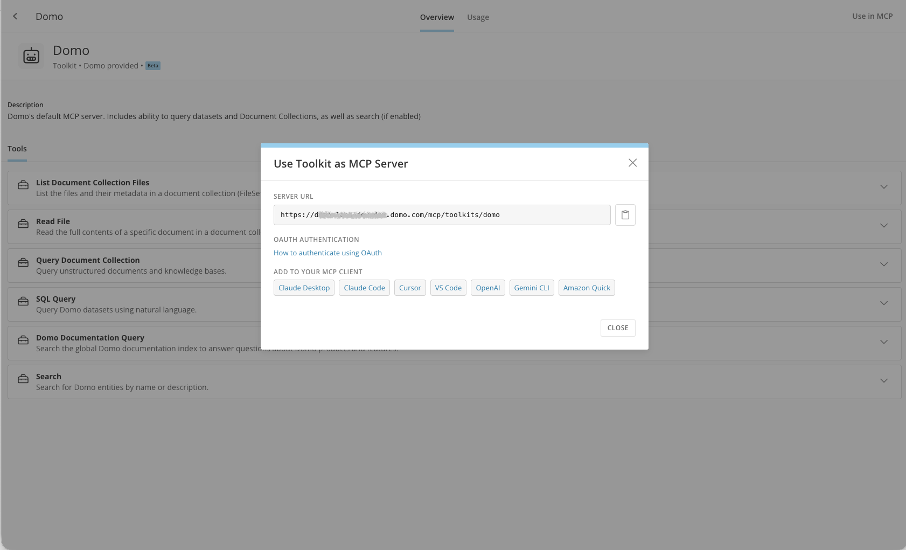
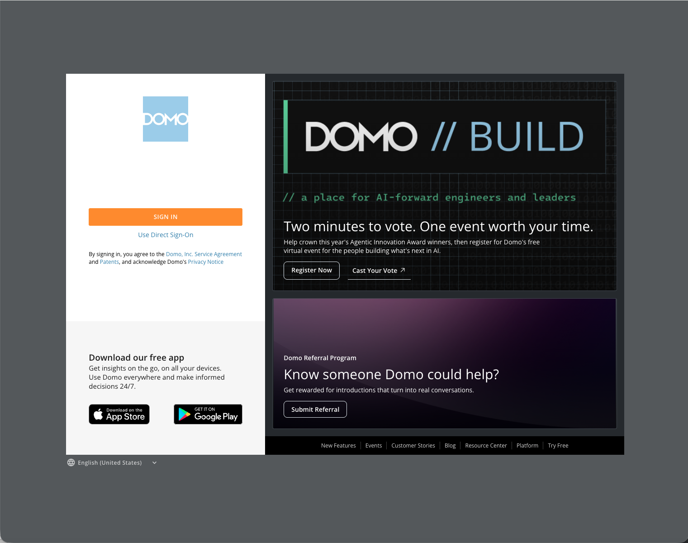

## Required Grants

To connect an AI tool to Domo's MCP Server, the following grants must be enabled for your role:

- **Use AI Services —** Access to features and Apps built using the AI Services Layer.
- **Use AI Chat —** Access to the Domo AI Assistant.
- **Use MCP —** Access to connect external AI tools to Domo's MCP Server.

Learn more about [grants](/s/article/360043438973).

## Prerequisites

- An AI tool that supports remote MCP servers with OAuth, such as Claude Desktop, Cursor, Gemini Enterprise, or Amazon Quick Suite.

- The **Domo MCP** server URL. Visit the [AI Library](/s/article/AI-Library) and retrieve the MCP server URL from the **Domo MCP** toolkit. Either URL works:

  ```
  https://<instance>.domo.com/mcp

  https://<instance>.domo.com/mcp/toolkits/domo
  ```

  <Note>**Note:** Replace `<instance>` with your actual Domo instance subdomain (for example, `mycompany` for `mycompany.domo.com`).</Note>

  <Frame></Frame>

## Follow a Guide for Your AI Tool

Step-by-step instructions are available for these AI tools:

- [Amazon Quick Suite](/s/article/Connect-Amazon-Quick-Suite-To-Domo-MCP)
- [Antigravity](/s/article/Connect-Antigravity-to-Domo-MCP)
- [Claude Code](/s/article/Connect-Claude-Code-to-Domo-MCP)
- [Claude Desktop](/s/article/Connect-Claude-Desktop-to-Domo-MCP)
- [Codex CLI](/s/article/Connect-Codex-CLI-to-Domo-MCP)
- [Cursor](/s/article/Connect-Cursor-to-Domo-MCP)
- [Gemini Enterprise](/s/article/Connect-Gemini-Enterprise-to-Domo-MCP)
- [GitHub Copilot CLI](/s/article/Connect-GitHub-Copilot-CLI-to-Domo-MCP)
- [Kiro](/s/article/Connect-Kiro-to-Domo-MCP)
- [VS Code](/s/article/Connect-VS-Code-to-Domo-MCP)

If your AI tool isn't listed, use the general steps below.

## Connect with OAuth

<Steps>
  <Step title="Add the Domo MCP Server to Your AI Tool">
    In your AI tool, open the settings where you add a custom connector or remote MCP server. The name and location of this setting vary by tool.

    Give the MCP server a name, such as `Domo MCP`, and paste the **Domo MCP** URL into the server URL field. If your AI tool asks for an authentication method, choose **OAuth**.

    <Note>**Note:** Some AI tools require a Client ID and Client Secret instead of discovering Domo's OAuth settings automatically. The [Gemini Enterprise](/s/article/Connect-Gemini-Enterprise-to-Domo-MCP) and [Amazon Quick Suite](/s/article/Connect-Amazon-Quick-Suite-To-Domo-MCP) guides show how to register an OAuth client in Domo for those cases.</Note>
  </Step>

  <Step title="Sign In to Domo">
    Start the connection from your AI tool and follow the prompts to log into your Domo instance.

    <Frame></Frame>
  </Step>

  <Step title="Allow Your AI Tool to Access Domo">
    On the consent screen that asks to allow your AI tool access to Domo, select **Allow**.

    <Frame></Frame>

    After authentication is complete, the connector is active and your AI tool has access to your Domo instance.
  </Step>
</Steps>

If your AI tool doesn't support OAuth, see [Manually Connect to the Domo MCP Server](/s/article/MCP-Manually-Connect) to connect with an access token instead.

## Consumption Considerations for MCP

MCP tool calls don't incur AI operation charges. However, if the tool that gets called uses any of the Domo-provided models, input and output token charges can apply.

## OAuth FAQ

<AccordionGroup>
<Accordion title="What if I don't know my Domo instance/subdomain?">
Your Domo instance subdomain is in the URL you use to log into Domo — for example, if you access Domo at `mycompany.domo.com`, your instance/subdomain is `mycompany`. Contact your Domo admin if you are unsure.
</Accordion>

<Accordion title="Can I connect multiple Domo instances?">
Yes. Repeat the steps in this article for each instance, using a unique connector name and the corresponding domain in the MCP server URL for each.
</Accordion>

<Accordion title="What data does my AI tool have access to once connected?">
Your AI tool can access the data and tools exposed by the Domo MCP toolkit, which includes querying DataSets and interacting with Domo features available through the MCP API. Access is scoped to what your Domo user account is permitted to see.
</Accordion>
</AccordionGroup>

## Related Articles

- [Connect AI Tools to Domo Using MCP](/s/article/Connect-AI-Tools-to-Domo-Using-MCP)
- [Manually Connect to the Domo MCP Server](/s/article/MCP-Manually-Connect)
