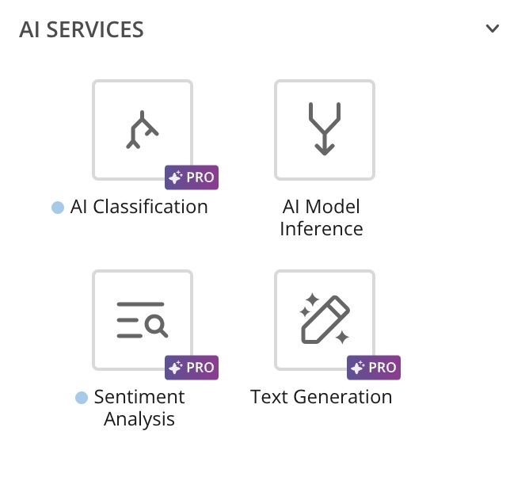

## Intro

See how you can put AI to work in Magic ETL. Learn about [Magic ETL AI Services](/s/article/000005741):

* [Collection Input](/s/article/Magic-ETL-Tiles-Documents#collection-input-tile)
* [Text Generation](/s/article/000005741#text-generation-tile)
* [Classification](/s/article/000005741#classification-tile-beta)
* [Sentiment Analysis](/s/article/000005741#sentiment-analysis-tile-beta)

<Frame></Frame>
