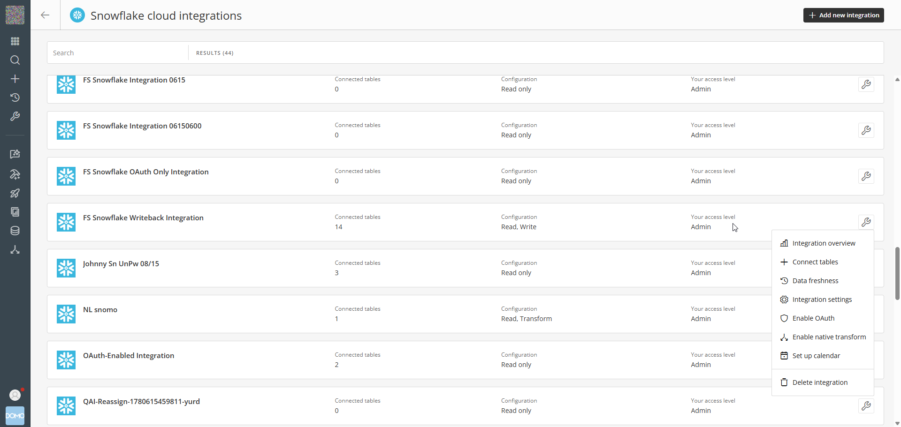
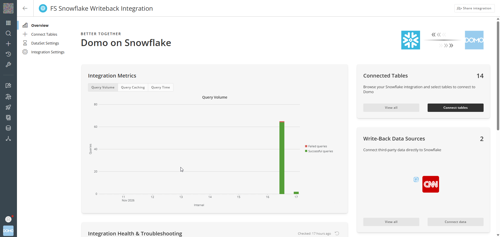
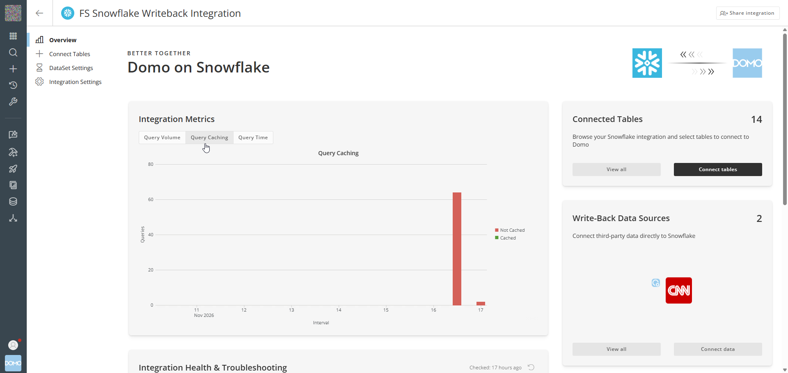
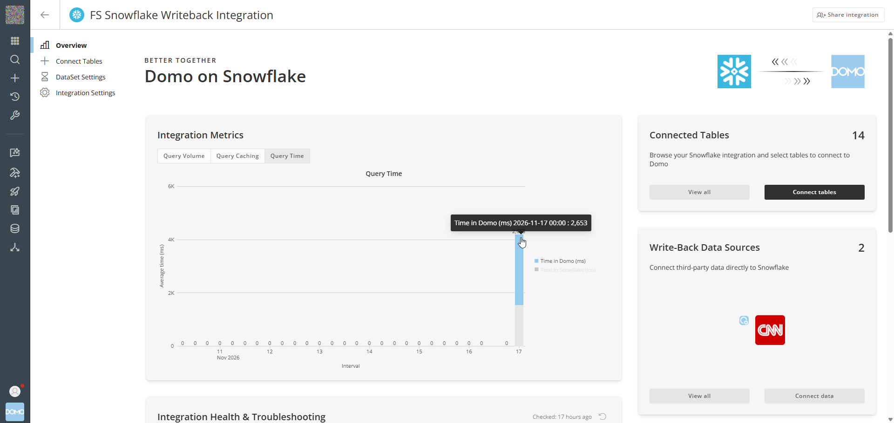
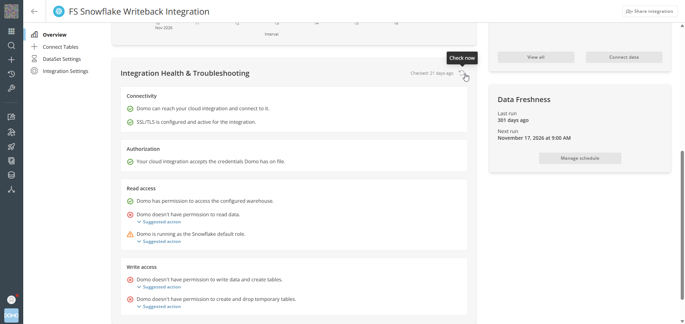
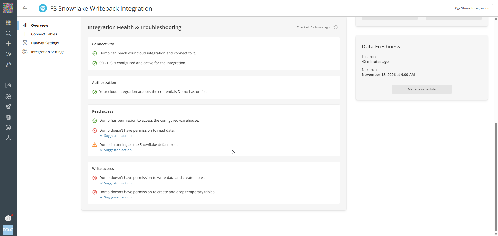
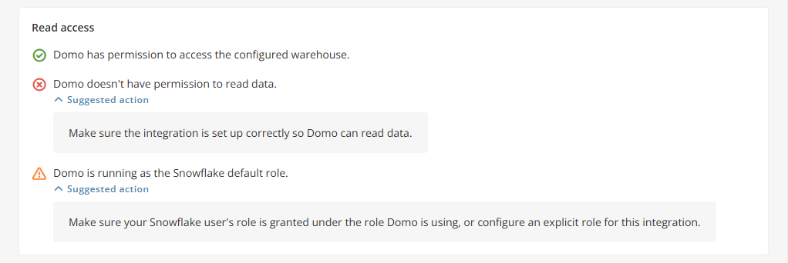
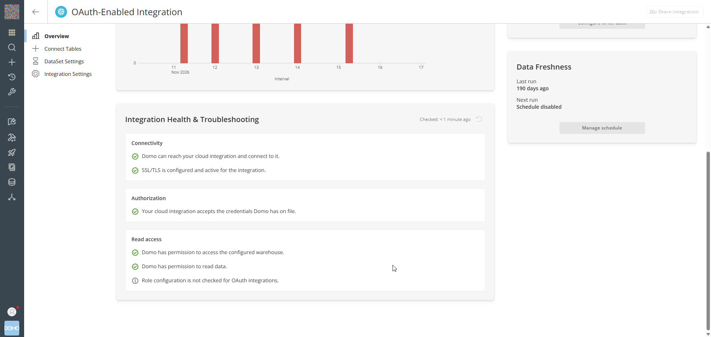

import { BetaNote } from '/snippets/BetaNote.mdx';

<BetaNote />

## Prerequisites

The integration must be shared with you. See [Share a Cloud Integrations Account](/s/article/4412849158167#share-a-cloud-integrations-account).

## Open the Integration Overview

When you create an integration, the confirmation screen takes you to its **Overview** tab. To open the **Overview** tab for an existing integration:

1. Navigate to **Data Warehouse** > **Connect Data** > **Manage existing integrations**.

2. Select the tile for your integration type, such as Snowflake or BigQuery.

3. Find the integration, select the wrench icon <i className="icon-wrench" aria-hidden="true" />, and then select **Integration overview**.
   The integration opens on the **Overview** tab. Use the left navigation to move between **Overview**, **Connect Tables**, **DataSet Settings**, and **Integration Settings**.

   <Frame></Frame>

   <Frame></Frame>

## Review Integration Metrics

The **Integration Metrics** card charts the queries that Domo sent to your warehouse through this integration over the last seven days. Select a tab to change the chart.

| Tab               | What it shows                                                                                                                                                   |
| ----------------- | --------------------------------------------------------------------------------------------------------------------------------------------------------------- |
| **Query Volume**  | The number of queries in each interval, split into "Successful queries" and "Failed queries"                                                                    |
| **Query Caching** | The number of queries in each interval, split into "Cached" queries that Domo answered from its cache and "Not Cached" queries that Domo sent to your warehouse |
| **Query Time**    | The average query time in milliseconds for each interval, split into time spent in Domo and time spent in your warehouse, such as "Time in Snowflake (ms)"      |

To see the value for an interval, hover over its bar. To hide or show a series, select its name in the legend.

<Frame></Frame>

<Frame></Frame>

To send fewer queries to your warehouse, adjust the integration's cache duration. See [Configure Data Freshness and Caching in Cloud Integrations](/s/article/Configure-Data-Freshness-and-Caching-in-Cloud-Integrations).

## Review Connected Tables and Write-Back Data Sources

Two cards summarize the data that moves between Domo and your warehouse through this integration:

- **Connected Tables —** The number of warehouse tables that are connected to Domo as DataSets. To see the connected tables, select **View all**. To connect more tables, select **Connect tables**. See [Connect Tables in Cloud Integrations](/s/article/Connect-Tables-in-Cloud-Integrations).
- **Write-Back Data Sources —** The number of third-party data sources that write data directly to your warehouse through this integration. To see these data sources, select **View all**. To add a data source, select **Connect data**.

The **Write-Back Data Sources** card appears only for integrations that support write-back.

## Check Integration Health

The **Integration Health & Troubleshooting** card shows the results of the most recent health check. A health check confirms that Domo can reach your warehouse, sign in with the credentials it has on file, and read and write data. Health checks run only when you start one.

### Run a Health Check

To run a health check, select the refresh icon <i className="icon-reset" aria-hidden="true" /> next to **Checked:** on the **Integration Health & Troubleshooting** card. When you hover over the icon, it shows **Check now**. "Loading..." appears while the check runs, and then the card shows the new results.

<Frame></Frame>

**Checked:** shows how long ago the last health check ran. To see the exact date and time, hover over it.

<Note>**Note:** After you run a health check, you must wait five minutes before you run another. Until then, the icon shows "Must wait 5 minutes" when you hover over it.</Note>

### Review the Results

The card groups the results into sections:

| Section           | What Domo checks                                                                                                                              |
| ----------------- | --------------------------------------------------------------------------------------------------------------------------------------------- |
| **Connectivity**  | Domo can reach your warehouse and connect to it, and SSL/TLS is configured and active.                                                        |
| **Authorization** | Your warehouse accepts the credentials Domo has on file.                                                                                      |
| **Read access**   | Domo can access the configured warehouse and read data. For Snowflake, Domo also checks which role it runs as.                                |
| **Write access**  | Domo can write data, create tables, and create and drop temporary tables. This section appears only for integrations that support write-back. |

Each result starts with an icon:

| Icon                                                                                   | Meaning                                               |
| -------------------------------------------------------------------------------------- | ----------------------------------------------------- |
| <i className="icon-check-circle" aria-hidden="true" /> Green check mark                | The check passed.                                     |
| <i className="icon-exclamation-triangle" aria-hidden="true" /> Orange warning triangle | The check passed, but the setup might cause problems. |
| <i className="icon-x-circle" aria-hidden="true" /> Red X                               | The check failed.                                     |
| <i className="icon-info-circle" aria-hidden="true" /> Info icon                        | Information about the check. No action is needed.     |

<Frame></Frame>

### Fix Failed Checks

1. Under a failed check or a warning, select **Suggested action** to see how to fix it.

   For example, for "Domo is running as the Snowflake default role.", the suggested action is "Make sure your Snowflake user's role is granted under the role Domo is using, or configure an explicit role for this integration."

   <Frame></Frame>

2. Make the suggested change in your warehouse or in the integration settings. For the permissions that Domo needs in Snowflake, see [Snowflake Minimum Permissions for Domo](/s/article/Snowflake-Minimum-Permissions-for-Domo).

3. [Run a health check](#run-a-health-check) again to confirm the fix.

### Health Checks for OAuth Integrations

For integrations with OAuth enabled, the health check doesn't check the role configuration. Instead, the **Read access** section shows the info result "Role configuration is not checked for OAuth integrations."

<Frame></Frame>

## Review Data Freshness

The **Data Freshness** card shows when Domo last checked your warehouse for updated data and when the next check is scheduled:

- **Last run —** How long ago the most recent data freshness check ran.
- **Next run —** The date and time of the next scheduled check. If scheduled checks are off, this shows "Schedule disabled".

To change the schedule, select **Manage schedule**. See [Configure Data Freshness Checks](/s/article/Configure-Data-Freshness-and-Caching-in-Cloud-Integrations#configure-data-freshness-checks).

## FAQ

<AccordionGroup>

<Accordion title="Why don't I see the Overview tab?">
The **Overview** tab is in beta, so it must be enabled for your Domo instance. You also need the integration to be shared with you. See [Share a Cloud Integrations Account](/s/article/4412849158167#share-a-cloud-integrations-account).
</Accordion>

<Accordion title="Why can't I run a health check?">
After a health check runs, you must wait five minutes before you run another. Until then, the icon next to **Checked:** shows "Must wait 5 minutes" when you hover over it.
</Accordion>

<Accordion title="Why doesn't the Write access section appear?">
The **Write access** section appears only for integrations that support write-back. Read-only integrations show only the **Connectivity**, **Authorization**, and **Read access** sections.
</Accordion>

</AccordionGroup>

## Related Articles

- [Cloud Integrations Overview](/s/article/4412849158167)
- [Connect Tables in Cloud Integrations](/s/article/Connect-Tables-in-Cloud-Integrations)
- [Configure Data Freshness and Caching in Cloud Integrations](/s/article/Configure-Data-Freshness-and-Caching-in-Cloud-Integrations)
- [Snowflake Minimum Permissions for Domo](/s/article/Snowflake-Minimum-Permissions-for-Domo)
