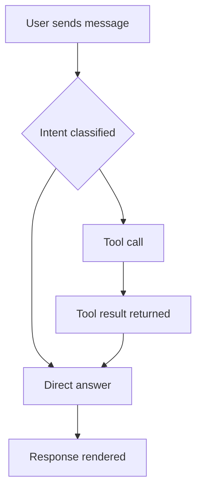

## Intro

This article explains the formats AI Chat recognizes in model responses and the syntax required to render each one. AI Chat does more than display plain text. When the model returns specific Markdown or HTML syntax, AI Chat replaces that content with a live, interactive element in place, such as a rendered chart, an interactive diagram, a code block with a copy button, or an embedded frame.

---

## Quick Reference

| Content type    | Trigger syntax                                                              | Rendered as                                                                                    |
| --------------- | --------------------------------------------------------------------------- | ---------------------------------------------------------------------------------------------- |
| Markdown        | Standard Markdown                                                           | Formatted text, such as headings, bold, italic, lists, and tables. This is the default format. |
| Code block      | Fenced code block with a language identifier (for example, `python`)        | Syntax-highlighted code block with a copy button                                               |
| Mermaid diagram | Fenced code block with the `mermaid` identifier                             | Live rendered flowchart, sequence, Gantt, ER, and other diagrams                               |
| Vega-Lite chart | Fenced code block with the `vega-lite` identifier                           | Interactive chart (bar, line, scatter, pie, and more)                                          |
| Inline image    | ``                                                               | Image rendered inline in the message                                                           |
| Inline SVG      | Fenced code block with the `svg` identifier, or a raw `<svg>` tag           | Vector graphic rendered directly in the message                                                |
| Link            | `[text](url)`                                                               | Clickable hyperlink; Domo URLs display a smart-link preview                                    |
| Iframe embed    | `<iframe src="…">` tag, or an `<iframe>` inside an `html` fenced code block | Sandboxed embedded view                                                                        |
| File preview    | ``                              | Inline file preview that expands to a modal                                                    |
| Domo card       | ``                                              | Live Domo card (chart or KPI) that expands to a modal                                          |
| Table           | Markdown pipe table                                                         | Formatted table with a header row                                                              |

## Format Text with Markdown

AI Chat supports standard CommonMark Markdown. Any text the model returns outside a fenced code block is parsed as Markdown first.

| Element         | Syntax                      |
| --------------- | --------------------------- |
| Heading         | `# H1` / `## H2` / `### H3` |
| Bold            | `**text**`                  |
| Italic          | `_text_`                    |
| Inline code     | `` `code` ``                |
| Bulleted list   | `- item` or `* item`        |
| Numbered list   | `1. item`                   |
| Blockquote      | `> text`                    |
| Horizontal rule | `---`                       |

## Add Code Blocks

Open a fenced code block with three backticks followed immediately by a language identifier. AI Chat applies syntax highlighting for that language and adds a copy button.

````markdown
```python
def hello(name: str) -> str:
  return f"Hello, {name}!"
```
````

Supported language identifiers include, but aren't limited to, `python`, `javascript` / `js`, `typescript` / `ts`, `sql`, `bash` / `sh`, `json`, `yaml`, `html`, `css`, `java`, `go`, `rust`, `ruby`, and `php`.

To create a language-agnostic monospace block, leave the identifier empty.

## Render Mermaid Diagrams

Use the `mermaid` language identifier to render an interactive diagram directly in the message. AI Chat renders the diagram with the Mermaid.js library at display time, so valid Mermaid syntax is all that's required.

````markdown

````

The following diagram types are supported:

- **`flowchart` / `graph` —** Directed graphs and flow diagrams
- **`sequenceDiagram` —** Message-passing sequence diagrams
- **`classDiagram` —** UML class diagrams
- **`erDiagram` —** Entity-relationship diagrams
- **`gantt` —** Project timelines
- **`pie` —** Pie and donut charts
- **`stateDiagram-v2` —** State machines
- **`journey` —** User journey maps
- **`mindmap` —** Hierarchical mind maps
- **`timeline` —** Chronological timelines
- **`xychart-beta` —** Bar and line charts

## Render Vega-Lite Charts

Use the `vega-lite` language identifier with a valid [Vega-Lite](https://vega.github.io/vega-lite/docs/) JSON specification to render an interactive chart. AI Chat passes the specification directly to the Vega-Lite runtime, so no wrapper is needed.

````markdown
```vega-lite
{
  "$schema": "https://vega.github.io/schema/vega-lite/v5.json",
  "description": "Monthly revenue by region",
  "data": {
    "values": [
      {"month": "Jan", "region": "West", "revenue": 42000},
      {"month": "Jan", "region": "East", "revenue": 31000},
      {"month": "Feb", "region": "West", "revenue": 48000},
      {"month": "Feb", "region": "East", "revenue": 35000}
    ]
  },
  "mark": "bar",
  "encoding": {
    "x": {"field": "month", "type": "ordinal"},
    "y": {"field": "revenue", "type": "quantitative"},
    "color": {"field": "region", "type": "nominal"}
  }
}
```
````

Common chart marks include `bar`, `line`, `point` (scatter), `area`, `arc` (pie or donut), `rule`, `tick`, and `boxplot`.

When an agent fetches live data from a DataSet tool, embed the rows directly in the `data.values` array.

<Tip>**Tip:** Keep embedded data under about 500 rows for client-side performance. For larger DataSets, pre-aggregate the data before returning the specification.</Tip>

## Add Inline Images

Standard Markdown image syntax displays an image inline in the message. The URL must be reachable from the user's browser, either publicly or from an authenticated Domo endpoint the browser already has a session for.

```markdown

```

To make an image a link, wrap the image syntax in link syntax:

```markdown
[](https://example.com/full-chart)
```

Images display at their natural size, capped at the width of the message container. Markdown has no syntax to override dimensions. If you need precise sizing, use an inline `` tag with explicit `width` and `height` attributes:

```html

```

## Render Inline SVG

You can render SVG content in two ways:

- **Fenced code block with the `svg` identifier —** AI Chat detects the `svg` identifier and renders the SVG markup directly.
- **Raw `<svg>` tag —** If the response contains a bare `<svg>` element outside a fenced code block, AI Chat renders it inline. This is useful for agents that generate SVG diagrams or icons programmatically.

````markdown
```svg
<svg xmlns="http://www.w3.org/2000/svg" viewBox="0 0 100 100" width="120" height="120">
  <circle cx="50" cy="50" r="40" fill="#005AFF" />
  <text x="50" y="55" text-anchor="middle" fill="white" font-size="14">Domo</text>
</svg>
```
````

<Note>**Note:** SVG renders in a sandboxed container. `<script>` tags inside SVG are removed, and external `xlink:href` references to untrusted origins are blocked. Keep SVG content self-contained.</Note>

## Add Links

Standard Markdown link syntax creates a clickable hyperlink:

```markdown
[View the sales dashboard](https://your-instance.domo.com/page/12345)
```

Bare URLs in text are linked automatically:

```markdown
See https://your-instance.domo.com/page/12345 for details.
```

Links to dashboards, cards, or DataSets on the same Domo instance display as smart-link chips that show the item's title and type icon. No extra syntax is required; AI Chat detects the domain automatically.

External links open in a new tab. Domo links open within the same Domo session.

## Embed Iframes

To embed an external page, dashboard, or interactive app in a response, return an `<iframe>` tag. AI Chat wraps it in a sandboxed container.

```html
<iframe
  src="https://your-instance.domo.com/embed/pages/public/abc123"
  width="100%"
  height="480"
  frameborder="0"
  allowfullscreen
></iframe>
```

Alternatively, place the `<iframe>` alone inside an `html` fenced code block. AI Chat renders it live rather than as code:

````markdown
```html
<iframe src="https://example.com/embed" width="100%" height="400"></iframe>
```
````

AI Chat applies the following sandbox attributes: `allow-scripts`, `allow-same-origin`, `allow-forms`, and `allow-popups`. The embedded site's `frame-ancestors` Content Security Policy controls whether it can be framed.

<Warning>**Important:** Private Domo dashboard embeds (`/embed/pages/private/…`) redirect to sign-in and can't be framed. Use public embeds, token-based embeds, or the DataSets API for Domo content.</Warning>

## Preview Files

Files stored in Domo FileSets display as an inline file preview in the response. To trigger a preview, use Markdown image syntax with a `domo://fileset/` URL.

```markdown

```

| Part                    | Description                                                                                                                                           |
| ----------------------- | ----------------------------------------------------------------------------------------------------------------------------------------------------- |
| Display name (alt text) | The title shown in the preview header and the expanded view. Use the file name with its extension (for example, `q3-report.csv`).                     |
| `fileSetId`             | The UUID of the FileSet that contains the file, as returned by the Domo Files API. Must be a lowercase UUID (`xxxxxxxx-xxxx-xxxx-xxxx-xxxxxxxxxxxx`). |
| `fileId`                | The UUID of the file within the FileSet, as returned by the Domo Files API. Must be a lowercase UUID.                                                 |

For example:

```markdown

```

The preview displays inline with a collapsible header that shows the display name. Select the expand button to open the file in a full-view modal. Each file reference in a response gets its own preview.

<Note>**Note:** A FileSet reference without a file ID (`domo://fileset/<fileSetId>`) doesn't display an inline preview. It appears only as a source chip in the **Sources** panel.</Note>

## Embed Domo Cards

To embed a saved Domo card, such as a chart or KPI, inline in a response, use Markdown image syntax with a `domo://card/` URL. AI Chat renders the live card in place of the image.

```markdown

```

| Part                  | Description                                                                                                                                                                       |
| --------------------- | --------------------------------------------------------------------------------------------------------------------------------------------------------------------------------- |
| Card title (alt text) | The title shown in the card header and the expanded view. Supports one level of balanced square brackets, for example `![[Exec] Bookings](domo://card/12345)`.                    |
| `cardId`              | The positive integer ID of a saved Domo card (for example, `42381`). Zero, negative, and non-numeric values display an error, because only saved cards have positive integer IDs. |

For example:

```markdown

```

The card displays inline in a collapsible header with the alt text as its title. A loading indicator appears while the card loads. After the card loads, select the expand button in the header to open the card details view.

If the card ID isn't a positive integer, or the card fails to load because it doesn't exist, the user lacks permission, or a render error occurs, an inline error message appears instead. A failed card doesn't affect the rest of the response.

## Format Tables

Pipe-delimited Markdown tables display as formatted tables with a sticky header row. Each table requires at least a header row and a separator row:

```markdown
| Region  | Q3 Revenue | Q3 Target | Attainment |
|---------|------------|-----------|------------|
| West    | $1.2M      | $1.0M     | 120%       |
| East    | $0.9M      | $1.1M     | 82%        |
| Central | $0.7M      | $0.8M     | 88%        |
```

Colons in the separator row control column alignment:

- **`|------|` —** Left-aligned (default)
- **`|:----:|` —** Center-aligned
- **`|-----:|` —** Right-aligned

Tables wider than the message container scroll horizontally. There's no row limit, but large tables (500 or more rows) are slow to render. For large data, return a Vega-Lite chart or a file preview instead.

## Combine Render Types

A single response can include multiple render types. AI Chat processes the full Markdown response and renders each matching block independently. For example, an agent response might combine text, a table, and a chart:

````markdown
Here is a summary of Q3 performance by region.

| Region | Revenue | Target | Attainment |
|--------|---------|--------|------------|
| West   | $1.2M   | $1.0M  | 120%       |
| East   | $0.9M   | $1.1M  | 82%        |

And here is the trend over the last four quarters:

```vega-lite
{
  "$schema": "https://vega.github.io/schema/vega-lite/v5.json",
  "mark": "line",
  "data": {
    "values": [
      {"quarter": "Q4 2024", "region": "West", "revenue": 1050000},
      {"quarter": "Q1 2025", "region": "West", "revenue": 1100000},
      {"quarter": "Q2 2025", "region": "West", "revenue": 1150000},
      {"quarter": "Q3 2025", "region": "West", "revenue": 1200000}
    ]
  },
  "encoding": {
    "x": {"field": "quarter", "type": "ordinal"},
    "y": {"field": "revenue", "type": "quantitative"},
    "color": {"field": "region", "type": "nominal"}
  }
}
```

West is the only region tracking above target. East and Central are both behind plan.
````
